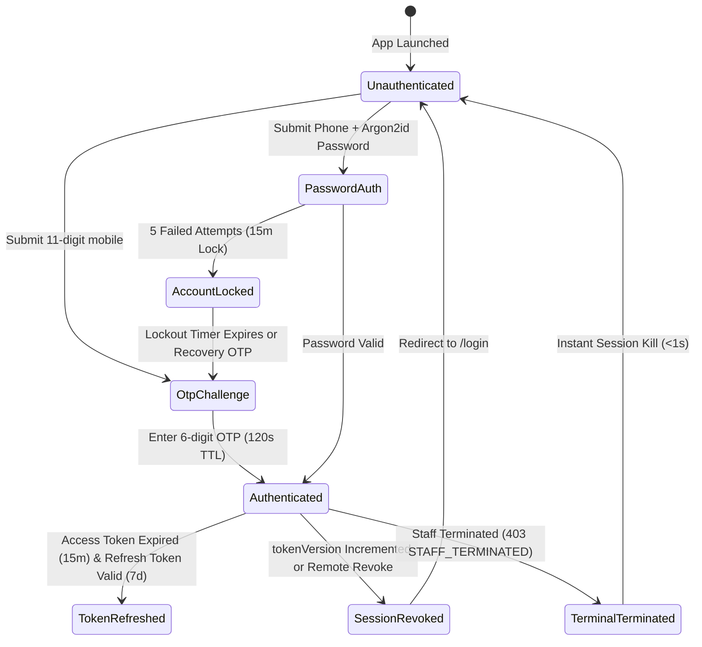
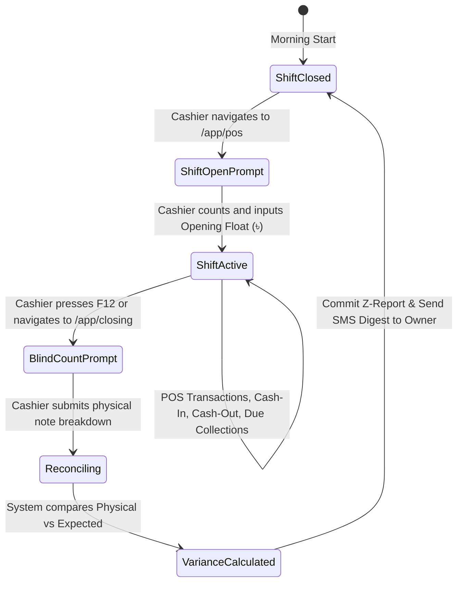
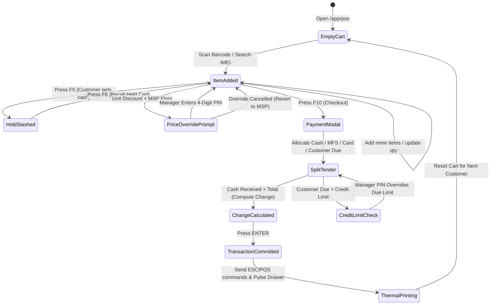
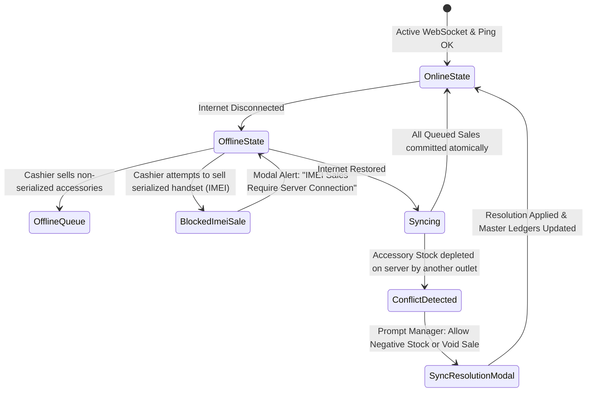
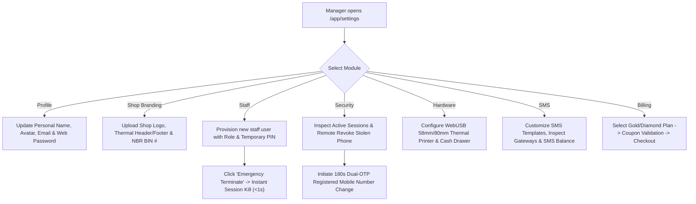
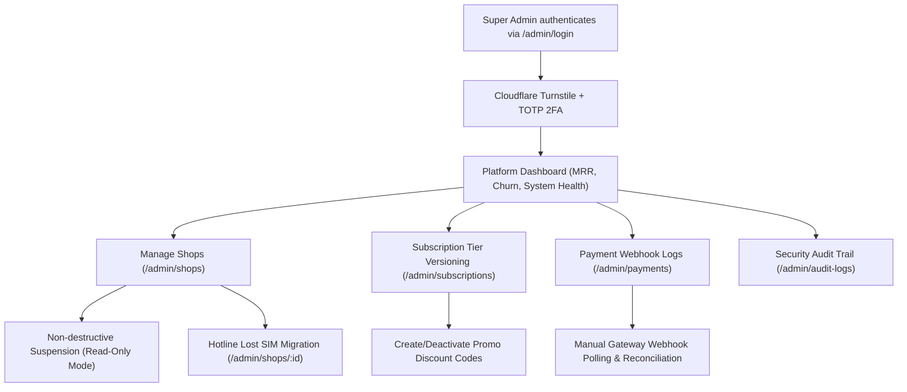

# Bebsayik.com — Master Application Flow & UI/UX Navigation Blueprint
**Document File:** `appflow.md`  
**System Name:** Bebsayik.com — Multi-Tenant Mobile Shop ERP & POS SaaS  
**Official Product Name:** Bebsayik  
**English Product Name:** Bebsayik.com  
**Brand:** Bebsayik | **Brand Attribution:** Powered by Bebsayik  
**Canonical Domain:** `bebsayik.com` (`app.bebsayik.com` | `admin.bebsayik.com`)  
**Heritage Context:** Initial ERP workflows originated from Kanchan Telecom retail operations; the SaaS platform is independently branded and operated as Bebsayik.com.  
**Version:** 2.0.0 (Hardened Master Application Blueprint)  
**Authoritative Scope:** Comprehensive Frontend Screen Inventory, Three-Tier Routing Model, Global State Machines, ASCII UI Wireframes, Mobile PWA Flows, Master Modal Directory, POS Hardware Drivers, UI Component Specifications, and Master Role-Based Action Matrix.

---

## 1. Executive Summary & Purpose

The purpose of this document is to define the definitive frontend navigation hierarchy, component screen layout, client-side state transitions, and user interaction mechanics for the **Bebsayik** platform. While [`prd.md`](file:///c:/Users/conta/OneDrive/Documents/Dokan%20Management%20Software/prd.md) specifies functional requirements and [`user-flow.md`](file:///c:/Users/conta/OneDrive/Documents/Dokan%20Management%20Software/user-flow.md) defines operational user journeys, **`appflow.md` serves as the blueprint for software engineers building the web and mobile user interfaces**.

### 1.1 Core Frontend Architectural Directives:
1. **Sub-Second POS Checkout (<3s):** The counter checkout view is strictly optimized for high-volume rush hours in Bangladeshi mobile markets (e.g., Eastern Plaza, Multiplan Center). Cashiers can scan, split payment, print thermal receipts, and kick cash drawers using pure keyboard accelerators (`F1`–`F12`) without touching a mouse.
2. **Zero-Data-Loss Offline Resilience:** Counter transactions for non-serialized accessories are cached in browser `IndexedDB` during internet drops. Serialized mobile handsets (IMEI) strictly enforce online server verification to prevent catastrophic double-selling across counter tablets.
3. **Absolute Role-Based UI Enclosure (RBAC):** UI elements, action buttons, margins, and financial metrics are conditionally rendered based on the 7 canonical RBAC roles. Cashiers and technicians never see gross profit margins, owner personal ledgers, or purchase landed costs.
4. **Hardware Driver Integration:** First-class browser WebUSB and Bluetooth support for 58mm/80mm ESC/POS thermal printers, RJ11 drawer pulse solenoids, and USB keyboard wedge barcode/IMEI scanners.

---

## 2. Three-Tier Multi-Host Routing Architecture

Bebsayik is engineered across three isolated subdomains. Each host enforces distinct layout shells, session guards, and routing trees:

```mermaid
flowchart TD
    subgraph Host1 ["Host 1: Public Marketing Portal (bebsayik.com)"]
        Landing["/ (Landing Page)"]
        Features["/features (Feature Deep Dive)"]
        Pricing["/pricing (SaaS Pricing & ROI Calc)"]
        About["/about (Company & Kanchan Heritage)"]
        Contact["/contact (Merchant Support)"]
        Register["/register (14-Day Gold Trial Signup)"]
        Login["/login (Dual Auth: OTP or Password)"]
        Recovery["/recovery (Turnstile SMS OTP Password Reset)"]
        Onboarding["/onboarding/setup (3-Step Wizard)"]
    end

    subgraph Host2 ["Host 2: Enterprise Web ERP (app.bebsayik.com)"]
        AppShell["/app (Global ERP Layout Shell & Top Nav)"]
        Dashboard["/app/dashboard (KPI Metrics & Quick Actions)"]
        POS["/app/pos (Counter POS & Split Payment)"]
        Returns["/app/sales/returns (Sales Return Hub)"]
        Inventory["/app/inventory (Dual-IMEI Master Registry)"]
        Transfers["/app/inventory/transfers (Godown ↔ Outlet STN)"]
        Damage["/app/inventory/damage (Scrap Write-Off SWV)"]
        Warranty["/app/inventory/warranty (Brand RMA Care Desk)"]
        Procure["/app/procurement (PO & Partial GRN Intake)"]
        Customers["/app/customers (Bakir Khata & Customer 360)"]
        Kisti["/app/kisti (Installment / EMI Ledgers)"]
        Buyback["/app/buyback (Used Phone Police Undertaking)"]
        Service["/app/service (Technician Lab & 50% Split)"]
        MfsDesk["/app/mfs-desk (100% Manual MFS Agent Ledger)"]
        Personal["/app/personal-ledger (Amanat & Hawlat - Owner Only)"]
        Closing["/app/closing (Day-End Blind Cash Count)"]
        HR["/app/hr/* (Targets, Quotas & Payroll)"]
        Reports["/app/reports/* (COGS, Aging, Profit & Loss)"]
        Settings["/app/settings/* (Profile, Shop, Staff, Security, SMS, Billing)"]
    end

    subgraph Host3 ["Host 3: Platform Admin Portal (admin.bebsayik.com)"]
        AdminLogin["/admin/login (Super Admin 2FA Sign-in)"]
        AdminDash["/admin/dashboard (Global MRR & System Health)"]
        AdminTenants["/admin/shops (Shop Directory & Suspension)"]
        AdminTenantDetail["/admin/shops/:id (Tenant Inspector & Hotline Phone Migration)"]
        AdminPlans["/admin/subscriptions (Plan Tiers & Coupons)"]
        AdminPayments["/admin/payments (Gateway Webhooks & Retries)"]
        AdminAudit["/admin/audit-logs (Security Audit Trail)"]
    end

    Host1 -->|Auth Success & Tenant JWT| Host2
    Host3 -->|Super Admin Context| Host2
```



---

## 3. Master Route & Screen Inventory

### 3.1 Public Marketing & Conversion Portal (`bebsayik.com`)
| Route | Component Name | Access Role Gate | Primary Capabilities & Page Responsibilities |
|---|---|:---:|---|
| `/` | `LandingPage` | Public | Hero value proposition, mobile retail ERP showcase, app badges, testimonials, CTA. |
| `/features` | `FeaturesPage` | Public | Deep dive into Dual-IMEI tracking, Kisti installment engine, Repair lab, and MFS float desk. |
| `/pricing` | `PricingPage` | Public | Subscription tiers (Free, Premium, Gold, Diamond), tenure toggles (10% 6M / 16% 1Y), interactive ROI calculator. |
| `/about` | `AboutPage` | Public | Company history, platform vision, retail heritage originating from Kanchan Telecom. |
| `/contact` | `ContactPage` | Public | Hotline numbers, Dhaka physical office address, WhatsApp onboarding assistance widget. |
| `/terms` | `TermsPage` | Public | Standard merchant terms of service, acceptable usage guidelines, and SLA commitments. |
| `/privacy` | `PrivacyPage` | Public | Data privacy compliance, encryption policies, zero third-party data selling pledge. |
| `/register` | `RegisterPage` | Public | 11-digit mobile number input + 6-digit SMS OTP verification (triggers 14-day Gold trial). |
| `/login` | `LoginPage` | Public | Passwordless SMS OTP sign-in or permanent Argon2id password sign-in for Web ERP. |
| `/recovery` | `RecoveryPage` | Public | Cloudflare Turnstile protected password recovery via verified SMS OTP challenge. |
| `/onboarding/setup` | `OnboardingWizard` | Auth (New Tenant) | 3-step setup wizard: Shop profile info -> Outlet setup -> Starting cash float ingestion. |

---

### 3.2 Enterprise Web ERP (`app.bebsayik.com`)
| Route | Component Name | Access Role Gate | Key Features & Screen Hierarchy |
|---|---|:---:|---|
| `/app/dashboard` | `DashboardView` | All Staff (Scoped) | Live turnover, cash drawer counter, low-stock alerts, fast action buttons. |
| `/app/pos` | `PosCounterView` | Cashier, Manager, Owner | Sub-second barcode/IMEI scan, F1-F12 shortcuts, split payment, change calculator. |
| `/app/sales/returns` | `SalesReturnView` | Cashier, Manager, Owner | 7-day return policy verification, device condition inspection, refund/exchange vouchers. |
| `/app/inventory` | `InventoryMasterView`| Stock Keeper, Manager, Owner| Master catalog, variant SKUs, 15-digit Dual-IMEI registry, aging stock filter. |
| `/app/inventory/transfers`| `StockTransferView` | Stock Keeper, Manager, Owner| Godown to Outlet Stock Transfer Notes (STN), dispatch IMEI scanning, dispute resolution. |
| `/app/inventory/damage` | `DamageScrapView` | Manager, Owner | Broken/water-damaged stock quarantine, Scrap Write-Off Vouchers (SWV). |
| `/app/inventory/warranty`| `WarrantyRmaView` | Manager, Stock, Owner | Brand warranty claims (RMA), distributor dispatches, return receipts. |
| `/app/procurement` | `ProcurementView` | Stock Keeper, Manager, Owner| Purchase Orders (PO), Partial GRN receiving, supplier advance deposits. |
| `/app/procurement/returns`| `PurchaseReturnView` | Stock Keeper, Manager, Owner| Purchase Return Vouchers (PRV) with landed cost reversal & supplier payable debit. |
| `/app/customers` | `CustomerDirectoryView`| Cashier, Manager, Owner| Customer profiles, Bakir Khata dues ledger, credit limits, money receipts. |
| `/app/customers/:id` | `CustomerDetailView` | Cashier, Manager, Owner| 4-Tab Customer 360° Profile: Invoices, Due Receipts, Kisti Contracts, Repair Jobs. |
| `/app/kisti` | `KistiMasterView` | Cashier, Manager, Owner | Installment contracts, dual guarantors with NID/phone, repayment schedules, default alerts. |
| `/app/buyback` | `BuybackRegistryView` | Cashier, Manager, Owner | Used phone purchase, webcam biometric/NID photo capture, police undertaking form. |
| `/app/service` | `RepairServiceView` | Technician, Manager, Owner | Repair job sheets, 3x3 pattern lock coordinates, spare parts, 50% labor split. |
| `/app/mfs-desk` | `MfsDeskView` | Cashier, Manager, Owner | 100% manual agent SIM float ledger (bKash/Nagad/Rocket), evening USSD audit. |
| `/app/personal-ledger` | `PersonalLedgerView` | **Shop Owner Solely** | Strictly isolated Amanat/Hawlat ledger, non-P&L "Expense on Behalf" tracking. |
| `/app/accounts` | `AccountsLedgerView` | Manager, Owner | Cash drawers, bank ledgers, OPEX expense vouchers, inter-account transfers. |
| `/app/closing` | `DayEndClosingView` | Cashier, Manager, Owner | Blind cash count drawer reconciliation, Z-Report generator, owner SMS digest. |
| `/app/hr/targets` | `EmployeeTargetsView` | Manager, Owner | Monthly handset unit quotas, gross revenue targets, tiered commission progress. |
| `/app/hr/payroll` | `PayrollLedgerView` | Manager, Owner | Technician 50% labor splits, sales commission accruals, salary disbursements. |
| `/app/reports` | `ReportsAnalyticsView`| Manager, Owner | Daily sales summary, item-specific COGS & profit, dead stock aging (>60d), balance sheet. |
| `/app/settings/profile` | `UserProfileView` | All Users | Personal name, avatar upload, email, password change, 4-digit PIN setup. |
| `/app/settings/shop` | `ShopProfileView` | Owner, Manager | Shop name, trade license, Mushak 6.3 BIN, logo upload, receipt header/footer. |
| `/app/settings/staff` | `StaffManagementView` | Owner, Manager (Read) | Staff directory, role provisioning, one-time PIN invite, instant termination. |
| `/app/settings/security` | `SecurityCenterView` | Owner, Manager | Device sessions, remote stolen phone revocation, Dual-OTP mobile migration. |
| `/app/settings/hardware` | `HardwareSetupView` | Owner, Manager | WebUSB/Bluetooth thermal printers (58mm/80mm), cash drawer pulse kick. |
| `/app/settings/sms` | `SmsSettingsView` | Owner, Manager | SMS templates customization, telecom gateway balance, delivery audit ledger. |
| `/app/settings/billing` | `SubscriptionBillingView`| **Shop Owner Solely** | Subscription plan details, coupon promo code input, PayStation/EPS checkout, invoices. |

---

### 3.3 Platform Admin Portal (`admin.bebsayik.com`)
| Route | Component Name | Access Role Gate | Key Features & Screen Hierarchy |
|---|---|:---:|---|
| `/admin/login` | `AdminLoginPage` | Public (Turnstile + 2FA) | Super Admin credentials + Mandatory SMS/TOTP 2FA verification. |
| `/admin/dashboard` | `AdminDashboardView` | Platform Super Admin | Global MRR, ARR, active shop tenant count, churn rate, gateway health. |
| `/admin/shops` | `TenantDirectoryView` | Platform Super Admin | Master shop list, plan status, non-destructive suspension, tenant inspector. |
| `/admin/shops/:id` | `TenantDetailModal` | Platform Super Admin | Tenant metadata, owner contact, read-only audit log, emergency phone migration. |
| `/admin/subscriptions` | `PlanPricingView` | Platform Super Admin | Subscription tier versioning, tenure discount policies, promo coupon engine. |
| `/admin/payments` | `PaymentWebhookView` | Platform Super Admin | Real-time payment gateway transaction logs (PayStation, EPS, bKash) & retry tools. |
| `/admin/audit-logs` | `PlatformAuditView` | Platform Super Admin | Central security audit trail, support impersonation logs, migration records. |

---

## 4. Application Global State Machines

### 4.1 Global App Shell & Top Navigation Layout Wireframe

```
+───────────────────────────────────────────────────────────────────────────────────────────────────+
| [Bebsayik Logo] | [🏢 Dokan 1: Eastern Plaza ▼] | [Search POS Ctrl+K] | [🔔 3] | [Shift: 🟢 ৳14,250] | [Sumon (Owner) ▼]|
+───────────────────────────────────────────────────────────────────────────────────────────────────+
| SIDEBAR NAV        | MAIN WORKSPACE CONTENT AREA                                                   |
| • Dashboard        |                                                                               |
| • POS Counter (F1) |                                                                               |
| • Sales Returns    |                                                                               |
| • Inventory & IMEI |                                                                               |
| • Godown Transfers |                                                                               |
| • Damaged Stock    |                                                                               |
| • Brand Warranty   |                                                                               |
| • Procurement (GRN)|                                                                               |
| • Customers & Due  |                                                                               |
| • Kisti (EMI)      |                                                                               |
| • Used Buyback     |                                                                               |
| • Repair Lab       |                                                                               |
| • MFS Agent Desk   |                                                                               |
| • Personal Ledger  |                                                                               |
| • Accounts & OPEX  |                                                                               |
| • Day Closing (F12)|                                                                               |
| • HR & Payroll     |                                                                               |
| • Reports          |                                                                               |
| • Settings Suite ▼ |                                                                               |
+───────────────────────────────────────────────────────────────────────────────────────────────────+
| SYSTEM FOOTER: [🟢 Cloud Sync: 100% Online] | [🖨️ WebUSB: 80mm Ready] | [Terminal: COUNTER-01] | v2.0.0 |
+───────────────────────────────────────────────────────────────────────────────────────────────────+
```

---

### 4.2 Authentication & Session State Machine



---

### 4.3 Cash Drawer & Shift Counter State Machine



---

### 4.4 POS Checkout & Cart State Machine



---

### 4.5 Offline-to-Online Conflict Sync & Reconciliation State Machine



#### Offline Sync Conflict Resolution Matrix:
| Event Scenario | Offline Action Permitted? | Sync Action on Reconnect | Ledger & Inventory Outcome |
|---|:---:|---|---|
| **Accessory Sale (Non-IMEI)** | Yes (Cached in IndexedDB) | Replays sale via batch API | Decrements `product_variants.stockQuantity` |
| **Mobile Handset Sale (IMEI)** | **STRICTLY BLOCKED** | N/A | Prevents catastrophic duplicate IMEI sales across tablets |
| **Concurrent Stock Depletion** | Yes (Offline cashier didn't know) | Prompts `SyncResolutionModal` | Manager chooses: (A) Allow negative stock, (B) Void & refund |
| **Customer Due Payment Receipt** | Yes (Cached locally) | Commits payment on server | Debits Cash Drawer, Credits Customer Receivables |

---

## 5. Screen-by-Screen Navigation Flows & UI Layouts

### 5.1 Public Marketing & Conversion Onboarding Flow

```
+───────────────────────────────────────────────────────────────────────────────────────────────────+
| Bebsayik.com | Features | Pricing | Heritage | Support                      [Log In] [Start Free] |
+───────────────────────────────────────────────────────────────────────────────────────────────────+
| [ HERO SECTION ]                                                                                  |
| Complete Mobile Shop Management ERP & Cloud POS Software                                          |
| Designed specifically for Bangladeshi Mobile & Gadget Retailers. Dual-IMEI, Kisti, Repair & MFS.  |
|                                                                                                   |
| [ 📱 Enter Mobile: 017XXXXXXXX ] -> [ 🚀 Start 14-Day Free Gold Trial ]                           |
+───────────────────────────────────────────────────────────────────────────────────────────────────+
| [ INTERACTIVE ROI CALCULATOR ]                                                                    |
| Monthly Phone Sales: [ 80 Handsets ] | Monthly Accessory Sales: [ ৳150,000 ]                      |
| Estimated Profit Leakage Prevented: ৳14,500 / month | Bebsayik Gold Plan: ৳1,499 / month           |
+───────────────────────────────────────────────────────────────────────────────────────────────────+
```

#### Web ERP Password Recovery Screen (`bebsayik.com/recovery`):
```
+───────────────────────────────────────────────────────────────────────────────────────────────────+
| Bebsayik.com — Secure Account Recovery                                                            |
+───────────────────────────────────────────────────────────────────────────────────────────────────+
| Step 1: Identity & Rate Limit Verification                                                         |
| Registered Mobile Number: [ 01712345678                                       ]                   |
| Cloudflare Turnstile:     [ ☑️ I am human (Turnstile Verified)                 ]                   |
|                           [ REQUEST 6-DIGIT RECOVERY OTP ] (Limit: 3 OTP / 15m)                    |
| ───────────────────────────────────────────────────────────────────────────────────────────────── |
| Step 2: SMS Verification & Password Reset                                                         |
| Enter SMS OTP:            [ _ _ _ _ _ _ ] (Expires in 118s)                                        |
| New Web Password:         [ •••••••••••••••••• ] (Min 8 chars, 1 number, 1 symbol)                |
| Confirm Password:         [ •••••••••••••••••• ]                                                  |
|                           [ RESET PASSWORD & INVALIDATE ALL OTHER SESSIONS ]                      |
+───────────────────────────────────────────────────────────────────────────────────────────────────+
```

---

### 5.2 POS Counter Workflow (`app.bebsayik.com/app/pos`)

```
+───────────────────────────────────────────────────────────────────────────────────────────────────+
| POS Counter Terminal | Counter: 01 | Cashier: Arif | Dokan: Eastern Plaza | Active Shift: ৳14,250 |
+───────────────────────────────────────────────────────────────────────────────────────────────────+
| F2 SEARCH / SCANNER:                                          | CUSTOMER: [ Walk-in Customer  ▼ ] |
| [ 🔍 Scan Barcode or Enter 15-Digit IMEI (F2)               ] | Credit Limit: ৳0.00 | Due: ৳0.00  |
+───────────────────────────────────────────────────────────────+───────────────────────────────────+
| ACTIVE CART ITEMS (2 Items):                                  | SUMMARY & PAYMENT (F10):          |
| # | Item Name & Variant      | IMEI / Serial   | Price | Qty | SubTotal:                ৳32,500.00|
| 1 | Redmi Note 13 Pro (8/128)| 860123456789012 | 27,500|  1  | Total Discount:            -৳500.00|
| 2 | 67W Fast Charger (Type-C)| ACC-CHARG-67W   |  5,500|  1  | Vat / Tax (0%):               ৳0.00|
|   |                          |                 |       |     | ────────────────────────────────── |
|   |                          |                 |       |     | GRAND TOTAL:             ৳32,000.00|
|   |                          |                 |       |     | ────────────────────────────────── |
|   |                          |                 |       |     | Paid Cash:               ৳32,000.00|
|   |                          |                 |       |     | Due / Change:                 ৳0.00|
+───────────────────────────────────────────────────────────────+───────────────────────────────────+
| [F3: Customer] [F4: Trade-In] [F5: Hold Cart] [F6: Returns] [F7: Kisti Mode] [F10: Checkout] [F12] |
+───────────────────────────────────────────────────────────────────────────────────────────────────+
```

---

### 5.3 Sales Return, Refund & Exchange Decision Hub (`/app/sales/returns`)

```
+───────────────────────────────────────────────────────────────────────────────────────────────────+
| Sales Return & Exchange Hub | Policy: 7 Days Return Permitted                                    |
+───────────────────────────────────────────────────────────────────────────────────────────────────+
| Step 1: Invoice & Device Lookup                                                                    |
| Invoice Number / Handset IMEI: [ INV-202610-00142               ] [ FETCH INVOICE ]               |
| Sale Date: 09-Oct-2026 (2 Days ago - RETURN ELIGIBLE) | Customer: Md. Rafiq (01811XXXXXX)         |
+───────────────────────────────────────────────────────────────────────────────────────────────────+
| Step 2: Item Inspection & Restock Condition                                                       |
| Selected Item: Redmi Note 13 Pro 5G | IMEI: 860123456789012 | Sold Price: ৳27,500.00               |
| Physical Condition:  (*) Intact / Like-New (Restock as Available Stock)                           |
|                      ( ) Defective / Hardware Fault (Route to Brand RMA Warranty Desk)             |
|                      ( ) Damaged by Customer (Reject Return / Process Paid Service)                |
+───────────────────────────────────────────────────────────────────────────────────────────────────+
| Step 3: Refund Settlement & Compensation Method                                                   |
| [1] Cash Refund from Register Drawer (৳27,500.00)                                                  |
| [2] Issue Store Credit / Exchange Voucher (Credit Balance for New Purchase)                        |
| [3] Deduct from Customer's Existing Bakir Khata Balance                                            |
| [ EXECUTE SALES RETURN & GENERATE REFUND SLIP (CRV-202610-00018) ]                                |
+───────────────────────────────────────────────────────────────────────────────────────────────────+
```

---

### 5.4 Dual-IMEI Inventory & Aging Registry (`/app/inventory`)

```
+───────────────────────────────────────────────────────────────────────────────────────────────────+
| Inventory Master & Dual-IMEI Stock Registry | Dokan: Eastern Plaza                                |
+───────────────────────────────────────────────────────────────────────────────────────────────────+
| Filters: [Category: Smartphones ▼] [Brand: Xiaomi ▼] [Status: Available ▼] [Aging: >60 Days ▼]   |
| Search:  [🔍 Search by Model, Barcode, or 15-Digit IMEI...                                       ] |
+───────────────────────────────────────────────────────────────────────────────────────────────────+
| IMEI 1          | IMEI 2          | Product & Variant      | Specific Cost | MRP      | Age (Days)|
| ─────────────── | ─────────────── | ────────────────────── | ───────────── | ──────── | ──────────|
| 860123456789012 | 860123456789013 | Redmi Note 13 Pro 8GB  | [🔒 ৳24,200]  | ৳27,500  | 14 Days   |
| 860987654321098 | 860987654321099 | Galaxy A55 5G 8/256GB  | [🔒 ৳38,000]  | ৳42,500  | 68 Days ⚠️|
| ACC-BAT-IP13PRO | N/A (Accessory) | iPhone 13 Pro Battery  | [🔒 ৳1,800]   | ৳2,800   | Stock: 14 |
+───────────────────────────────────────────────────────────────────────────────────────────────────+
| [➕ ADD PRODUCT] | [📥 IMPORT EXCEL] | [📦 RECEIVE GRN] | [🚚 STOCK TRANSFER] | [🏷️ PRINT LABELS] |
+───────────────────────────────────────────────────────────────────────────────────────────────────+
```

---

### 5.5 Godown ↔ Outlet Stock Transfer Note (STN) Hub (`/app/inventory/transfers`)

```
+───────────────────────────────────────────────────────────────────────────────────────────────────+
| Inter-Outlet Stock Transfer (STN) | Origin: Central Godown ➔ Destination: Eastern Plaza Outlet     |
+───────────────────────────────────────────────────────────────────────────────────────────────────+
| Transfer Voucher: STN-202610-0042 | Dispatch Date: 11-Oct-2026 | Status: In-Transit (Dispatched)  |
+───────────────────────────────────────────────────────────────────────────────────────────────────+
| Scanned Dispatched Handsets (3 Units):                                                            |
| 1. iPhone 15 Pro Max 256GB  | IMEI: 350123456789012 | Status: [ Dispatched by Godown Staff ]      |
| 2. Redmi Note 13 Pro 8/128  | IMEI: 860123456789012 | Status: [ Dispatched by Godown Staff ]      |
| 3. Samsung Galaxy S24 Ultra | IMEI: 990123456789012 | Status: [ Dispatched by Godown Staff ]      |
+───────────────────────────────────────────────────────────────────────────────────────────────────+
| Destination Receiving Verification:                                                               |
| Scan Received IMEIs: [ 🔍 Scan IMEI laser barcode to verify...                                   ] |
| Scanned & Verified: 2/3 Units | Missing: Samsung Galaxy S24 Ultra (Flagged Discrepancy)           |
+───────────────────────────────────────────────────────────────────────────────────────────────────+
| [CONFIRM PARTIAL RECEIVING & RESTOCK] | [DISPUTE & ESCALATE MISSING UNIT TO OWNER]                 |
+───────────────────────────────────────────────────────────────────────────────────────────────────+
```

---

### 5.6 Damaged / Shattered Stock Scrap Hub (SWV) (`/app/inventory/damage`)

```
+───────────────────────────────────────────────────────────────────────────────────────────────────+
| Damaged Stock Quarantine & Scrap Write-Off Hub | Dokan: Eastern Plaza                              |
+───────────────────────────────────────────────────────────────────────────────────────────────────+
| Filter: [All Scrapped Stock ▼] | Date Range: [This Month ▼] | Total Scrapped Cost: ৳34,200.00    |
+───────────────────────────────────────────────────────────────────────────────────────────────────+
| Step 1: Log Damaged Device or Accessory Scrap Voucher (SWV)                                       |
| Scan/Enter IMEI:      [ 860123456789099             ] -> Model: Redmi Note 13 Pro (Frozen: ৳24,200)|
| Damage Category:      (*) Customer Handset Drop / Broken Display in Store                          |
|                       ( ) Motherboard Dead-On-Arrival (Distributor Out of Warranty)                 |
|                       ( ) Water Damage / Swollen Battery Hazard                                    |
| Defect Description:   [ Customer dropped device while inspecting; LCD shattered, no display       ] |
| Webcam Damage Photo:  [ 📷 CAPTURE PHOTO PROOF ] [ photo_redmi_shatter_11oct.jpg (Uploaded) ]      |
| Manager PIN Auth:     [ •••• ] (Requires Manager or Store Owner PIN)                               |
+───────────────────────────────────────────────────────────────────────────────────────────────────+
| Accounting Impact: Cr. Inventory Asset (৳24,200) | Dr. Damaged Stock Scrap Loss OPEX (৳24,200)     |
| [ GENERATE SCRAP WRITE-OFF VOUCHER (SWV-202610-00007) & QUARANTINE ITEM ]                          |
+───────────────────────────────────────────────────────────────────────────────────────────────────+
```

---

### 5.7 Brand Warranty (RMA) Customer Care Tracking Hub (`/app/inventory/warranty`)

```
+───────────────────────────────────────────────────────────────────────────────────────────────────+
| Brand Warranty (RMA) Tracking Desk | Partner Brands: Xiaomi, Samsung, Realme, Vivo, Apple         |
+───────────────────────────────────────────────────────────────────────────────────────────────────+
| Active RMA Claims (12 Devices Out):                                                               |
| Claim #        | Customer Phone | Brand / Model      | IMEI 1          | Status      | Brand Courier Ticket|
| ────────────── | ────────────── | ────────────────── | ─────────────── | ─────────── | ───────────────────|
| RMA-202610-018 | 01711-223344   | Xiaomi Note 13 Pro | 860123456789012 | At Brand    | SA-PARCEL-981242   |
| RMA-202610-019 | 01822-334455   | Samsung Galaxy A55 | 860987654321098 | Ready Pick  | STEADFAST-412412   |
+───────────────────────────────────────────────────────────────────────────────────────────────────+
| Quick Intake New Customer Warranty Claim:                                                         |
| Customer Mobile: [ 01712345678         ] -> Name: Tanvir Ahmed                                    |
| Handset IMEI:    [ 860123456789044     ] -> Verify Purchase Date: 15-Jun-2026 (Under Warranty)    |
| Defect Reported: [ Camera focus vibrating, mic not working                                       ] |
| Brand Dispatched:[ Sundarban Courier   ] Ticket #: [ SC-DHAKA-84124 ] Tech: [ Arif Hossain      ] |
+───────────────────────────────────────────────────────────────────────────────────────────────────+
| [INTAKE & PRINT CUSTOMER RMA SLIP] | [SMS CUSTOMER "DEVICE SENT TO BRAND CARE"]                    |
+───────────────────────────────────────────────────────────────────────────────────────────────────+
```

---

### 5.8 Procurement & Partial GRN Goods Intake (`/app/procurement`)

```
+───────────────────────────────────────────────────────────────────────────────────────────────────+
| Procurement & Goods Received Note (GRN) | Supplier: Dhaka Mobile Syndicate (01711XXXXXX)          |
+───────────────────────────────────────────────────────────────────────────────────────────────────+
| PO Reference: PO-202610-0089 | Expected Handsets: 10 Units | Received: 7 Units (PARTIAL INTAKE)   |
+───────────────────────────────────────────────────────────────────────────────────────────────────+
| Scan & Ingest IMEI Serials for Redmi Note 13 Pro (Unit Landed Cost: ৳24,200.00):                  |
| 1. [ 860123456789011 ] | IMEI 2: [ 860123456789012 ] | Status: Validated (Luhn OK)                |
| 2. [ 860123456789013 ] | IMEI 2: [ 860123456789014 ] | Status: Validated (Luhn OK)                |
| 3. [ 860123456789015 ] | IMEI 2: [ 860123456789016 ] | Status: DUPLICATE DETECTED (Already in DB)⚠️|
+───────────────────────────────────────────────────────────────────────────────────────────────────+
| Total Ingested This Batch: ৳169,400.00 (7 Units) | Remaining Backorder: 3 Units                   |
| Supplier Payable Ledger: [Cr. Dhaka Mobile Syndicate: ৳169,400.00]                                 |
+───────────────────────────────────────────────────────────────────────────────────────────────────+
| [CONFIRM PARTIAL GRN & FREEZE SPECIFIC COSTS] | [GENERATE BACKORDER DISCREPANCY NOTE]             |
+───────────────────────────────────────────────────────────────────────────────────────────────────+
```

---

### 5.9 Customer Due & Bakir Khata Ledger (`/app/customers`)

```
+───────────────────────────────────────────────────────────────────────────────────────────────────+
| Customer Directory & Bakir Khata Dues Ledger | Dokan: Eastern Plaza                               |
+───────────────────────────────────────────────────────────────────────────────────────────────────+
| Filter: [All Debtors ▼] | Total Outstanding Due Receivables: ৳148,500.00 | Defaulters (>30d): 3   |
+───────────────────────────────────────────────────────────────────────────────────────────────────+
| Customer Name   | Mobile Number | Total Purchased | Outstanding Due | Credit Limit | Due Age     |
| ─────────────── | ───────────── | ─────────────── | ─────────────── | ──────────── | ─────────── |
| Md. Rafiqul     | 01811-223344  | ৳112,000.00     | ৳14,500.00      | ৳20,000.00   | 12 Days     |
| Kamal Hossain   | 01722-334455  | ৳48,000.00      | ৳8,000.00       | ৳10,000.00   | 42 Days ⚠️  |
+───────────────────────────────────────────────────────────────────────────────────────────────────+
| Actions for Selected Debtor: Md. Rafiqul (Due: ৳14,500.00)                                        |
| [💵 COLLECT DUE CASH / MFS] | [📩 SEND SMS DUE REMINDER] | [👁️ VIEW FULL 360° PROFILE & HISTORY] |
+───────────────────────────────────────────────────────────────────────────────────────────────────+
```

#### Customer 360° Profile 4-Tab View (`/app/customers/:id`):
```
+───────────────────────────────────────────────────────────────────────────────────────────────────+
| Customer 360° Profile: Md. Rafiqul Islam | Phone: 01811-223344 | Address: Malibagh, Dhaka         |
| Total Spent: ৳112,000.00 | Total Purchases: 6 | Outstanding Due: ৳14,500.00 | Credit Limit: ৳20,000|
+───────────────────────────────────────────────────────────────────────────────────────────────────+
| [ TAB 1: Invoices ] | [ TAB 2: Due Repayments ] | [ TAB 3: Kisti Contracts ] | [ TAB 4: Repairs ] |
+───────────────────────────────────────────────────────────────────────────────────────────────────+
| Tab 1: Sales Invoices History:                                                                    |
| • INV-202610-00142 | 09-Oct-2026 | Redmi Note 13 Pro | Total: ৳27,500 | Paid: ৳17,500 | Due: ৳10,000|
| • INV-202608-00089 | 15-Aug-2026 | 67W Fast Charger  | Total: ৳4,500  | Paid: ৳0      | Due: ৳4,500 |
+───────────────────────────────────────────────────────────────────────────────────────────────────+
| [💵 COLLECT DUE] | [📱 SEND DUE PAYMENT SMS] | [🖨️ PRINT STATEMENT] | [✏️ EDIT CREDIT LIMIT]     |
+───────────────────────────────────────────────────────────────────────────────────────────────────+
```

---

### 5.10 Installment (Kisti / EMI) & Hybrid Trade-In Down Payment (`/app/kisti`)

```
+───────────────────────────────────────────────────────────────────────────────────────────────────+
| Installment (Kisti / EMI) Contract Booking | Dokan: Eastern Plaza                                 |
+───────────────────────────────────────────────────────────────────────────────────────────────────+
| Customer: Md. Belal (01712-334455) | NID: 19922612345678901 | Verified Biometric NID Attached     |
| Handset: Galaxy S24 Ultra 12GB/256GB | Cash Price: ৳135,000.00 | Kisti Markup (+10%): ৳148,500.00 |
+───────────────────────────────────────────────────────────────────────────────────────────────────+
| Hybrid Down Payment Allocation:                                                                   |
| • Cash Received at Counter:            ৳25,000.00                                                 |
| • Second-Hand Phone Trade-In Voucher:  ৳18,500.00 (TV-202610-0019 / Used Redmi Note 10 Pro)       |
| Total Effective Down Payment:          ৳43,500.00                                                 |
| Remaining Financed Loan:               ৳105,000.00 (6 Monthly Installments @ ৳17,500.00 / month)   |
+───────────────────────────────────────────────────────────────────────────────────────────────────+
| Dual Guarantor Verification:                                                                      |
| G1: Belal's Brother (01911-223344, NID Verified) | G2: Shop Neighbor (01811-334455, NID Verified) |
+───────────────────────────────────────────────────────────────────────────────────────────────────+
| [CREATE 6-MONTH REPAYMENT SCHEDULE] | [GENERATE LEGAL UNDERTAKING STAMP PAPER]                     |
+───────────────────────────────────────────────────────────────────────────────────────────────────+
```

---

### 5.11 Used Phone Buyback & Police Compliance Undertaking (`/app/buyback`)

```
+───────────────────────────────────────────────────────────────────────────────────────────────────+
| Second-Hand Phone Buyback & Police Compliance Desk | Agreement: BBA-202610-0034                   |
+───────────────────────────────────────────────────────────────────────────────────────────────────+
| Seller Profile:                                                                                   |
| Name: Md. Sazzad Hossain | Phone: 01711-998877 | NID Number: 19882691234567890                    |
| [📷 CAPTURE SELLER LIVE WEBCAM PHOTO] | [📷 SCAN PHYSICAL NID FRONT & BACK]                       |
+───────────────────────────────────────────────────────────────────────────────────────────────────+
| Handset Verification:                                                                             |
| Brand & Model: iPhone 12 Pro Max 128GB | IMEI 1: 350987654321098 | IMEI 2: 350987654321099        |
| iCloud / Google FRP Status: Unlocked & Factory Reset Verified | Box Included: (X) Yes  ( ) No     |
| Agreed Buyback Valuation: ৳42,000.00                                                              |
+───────────────────────────────────────────────────────────────────────────────────────────────────+
| Payout Settlement:                                                                                |
| (*) Payout Cash from Drawer (৳42,000.00)                                                          |
| ( ) Issue Trade-In Voucher for Store Purchase (Voucher # TV-202610-00034)                         |
+───────────────────────────────────────────────────────────────────────────────────────────────────+
| [PRINT BANGLADESH POLICE UNDERTAKING FORM WITH PHOTO] | [RESTOCK PHONE AS AVAILABLE INVENTORY]    |
+───────────────────────────────────────────────────────────────────────────────────────────────────+
```

---

### 5.12 Technician Servicing Lab & Spare Parts Stock Return (`/app/service`)

```
+───────────────────────────────────────────────────────────────────────────────────────────────────+
| Technician Servicing Lab & Job Sheet Registry | Job #: REP-202610-0078                           |
+───────────────────────────────────────────────────────────────────────────────────────────────────+
| Customer: Sumon Paul (01811-556677) | Device: Samsung Galaxy S21 FE 5G | IMEI: 350112233445566    |
| Issue Reported: Green line on display, back panel cracked | Pattern Lock: [ 1-2-3-5-9 Recorded ]  |
+───────────────────────────────────────────────────────────────────────────────────────────────────+
| Parts & Labor Billing:                                                                            |
| Spare Part: OLED Display Module (Cost: ৳6,200.00 | Billed: ৳8,500.00)                             |
| Technician Repair Labor Fee:        ৳1,500.00                                                     |
| Total Service Bill:                 ৳10,000.00                                                    |
+───────────────────────────────────────────────────────────────────────────────────────────────────+
| 50% Maker Split Engine:                                                                           |
| Technician Labor Share (50% of ৳1,500): ৳750.00 (Accrued to Tech: Sumon Dash)                     |
| Store Labor Share (50% of ৳1,500):      ৳750.00 (Store Service Revenue)                           |
+───────────────────────────────────────────────────────────────────────────────────────────────────+
| Spare Part Return Workflow (If repair aborted or display defective):                              |
| [🔄 RETURN OLED DISPLAY TO GODOWN STOCK] -> Reason: Defective replacement panel                   |
| [MARK REPAIR COMPLETED & NOTIFY CUSTOMER VIA SMS] | [DELIVER PHONE & PRINT MONEY RECEIPT]         |
+───────────────────────────────────────────────────────────────────────────────────────────────────+
```

---

### 5.13 100% Manual MFS Agent Desk & Evening Float Audit (`/app/mfs-desk`)

```
+───────────────────────────────────────────────────────────────────────────────────────────────────+
| 100% Manual MFS Agent Desk | Provider: bKash Agent (SIM Slot 1) | Balance: Float ৳42,500 / Cash ৳0 |
+───────────────────────────────────────────────────────────────────────────────────────────────────+
| Quick Transaction Entry (Manual Merchant Verification - Zero SIM Scraping):                       |
| Transaction Type:   (*) Cash-In (Customer gives Cash, Agent sends e-Money)                        |
|                     ( ) Cash-Out (Customer sends e-Money, Agent gives Cash)                       |
| Amount (৳):         [ 5,000.00      ] | Customer Mobile: [ 01712-334455 ]                         |
| bKash TrxID:        [ BJK89124LA    ] (Entered manually from physical agent phone screen)         |
+───────────────────────────────────────────────────────────────────────────────────────────────────+
| Ledger Effect Preview:                                                                            |
| (+) Physical Drawer Cash: +৳5,000.00 | (-) Digital Float: -৳5,000.00 | Fee Earned: ৳20.50         |
+───────────────────────────────────────────────────────────────────────────────────────────────────+
| Evening Float & Cash Audit:                                                                       |
| Physical SIM USSD Dial Balance: [ ৳37,500.00 ] vs System Expected Float: [ ৳37,500.00 ]           |
| Float Variance: ৳0.00 (BALANCED)                                                                  |
+───────────────────────────────────────────────────────────────────────────────────────────────────+
| [COMMIT TRANSACTION SLIP] | [RECONCILE EVENING MFS CLOSING]                                       |
+───────────────────────────────────────────────────────────────────────────────────────────────────+
```

---

### 5.14 Segregated Personal Ledger (Amanat & Hawlat) (`/app/personal-ledger`)

```
+───────────────────────────────────────────────────────────────────────────────────────────────────+
| Strictly Segregated Personal Ledger (0.00% Store P&L Impact) | Access: SHOP OWNER SOLELY          |
+───────────────────────────────────────────────────────────────────────────────────────────────────+
| Contact Directory: [ Brother Rafiq (Hawlat: ৳25,000 Due) ▼ ] | Filter: [All Transactions ▼]       |
+───────────────────────────────────────────────────────────────────────────────────────────────────+
| Transaction Type:                                                                                 |
| ( ) Amanat In (Safe Deposit - Store holds personal money)                                         |
| ( ) Amanat Return (Store returns held deposit to person)                                          |
| (*) Hawlat Out (Personal Loan given to contact from store register cash)                          |
| ( ) Hawlat Repaid (Contact repays personal loan back into store register cash)                    |
| ( ) Expense on Behalf (Shop pays third-party bill for contact - Non-P&L receivable)               |
+───────────────────────────────────────────────────────────────────────────────────────────────────+
| Transaction Amount: [ ৳10,000.00    ] | Cash Source: [ Drawer Cash Register (Counter 01) ▼ ]     |
| Purpose / Note:     [ Brother Rafiq personal emergency loan for school fee                       ] |
+───────────────────────────────────────────────────────────────────────────────────────────────────+
| Accounting Isolation Invariant:                                                                   |
| Dr. Personal Receivable - Brother Rafiq: ৳10,000.00                                               |
| Cr. Cash Drawer Asset:                    ৳10,000.00                                               |
| Net Store P&L Impact:                    ৳0.00 (STRICT ZERO-IMPACT INVARIANT MAINTAINED)          |
+───────────────────────────────────────────────────────────────────────────────────────────────────+
| [POST PERSONAL TRANSACTION & ISSUE VOUCHER (PV-202610-0012)]                                      |
+───────────────────────────────────────────────────────────────────────────────────────────────────+
```

---

### 5.15 Day-End Cash Closing & Blind Note Count Reconciliation (`/app/closing`)

```
+───────────────────────────────────────────────────────────────────────────────────────────────────+
| Day-End Cash Closing & Blind Register Reconciliation (Z-Report) | Date: 11-Oct-2026               |
+───────────────────────────────────────────────────────────────────────────────────────────────────+
| Step 1: Blind Physical Cash Count (Cashier counts notes without seeing system target):            |
| ৳1,000 x [ 42 ] = ৳42,000.00   |   ৳500 x [ 15 ] = ৳7,500.00   |   ৳200 x [ 10 ] = ৳2,000.00     |
| ৳100   x [ 25 ] = ৳2,500.00    |   ৳50  x [ 12 ] = ৳600.00     |   ৳20  x [ 20 ] = ৳400.00       |
| Total Physical Cash Counted in Drawer: ৳55,000.00                                                 |
+───────────────────────────────────────────────────────────────────────────────────────────────────+
| Step 2: System Automatic Reconciliation (Unlocked after count submission):                       |
| Starting Morning Float:            ৳2,000.00                                                      |
| (+) Today's Cash Sales:           ৳68,500.00                                                      |
| (+) Customer Due Cash Collected:  ৳12,000.00                                                      |
| (-) Supplier Cash Paid:          -৳20,000.00                                                      |
| (-) Day OPEX Expenses:            -৳2,500.00                                                      |
| (-) Customer Cash Refunds:        -৳5,000.00                                                      |
| Expected Cash in Drawer:          ৳55,000.00                                                      |
| Variance: ৳0.00 (PERFECT BALANCED CLOSING)                                                        |
+───────────────────────────────────────────────────────────────────────────────────────────────────+
| If Variance != 0: [ RECOUNT DRAWER ONCE (1 ATTEMPT REMAINING) ] | [ COMMIT VARIANCE & LOCK REGISTER ] |
| Action Buttons:   [COMMIT DAY-END CLOSING & LOCK REGISTER] | [SEND Z-REPORT SMS DIGEST TO OWNER PHONE]  |
+───────────────────────────────────────────────────────────────────────────────────────────────────+
```

---

### 5.16 Employee Sales Targets & Technician Commission Payroll (`/app/hr/*`)

```
+───────────────────────────────────────────────────────────────────────────────────────────────────+
| HR, Sales Quotas & Technician 50% Commission Payroll | Target Month: October 2026                 |
+───────────────────────────────────────────────────────────────────────────────────────────────────+
| Sales Executive Handset Targets:                                                                  |
| Employee Name  | Handset Target | Handsets Sold | Revenue Achieved | Commission Rate | Accrued BDT|
| ────────────── | ────────────── | ───────────── | ──────────────── | ─────────────── | ───────────|
| Tanvir Ahmed   | 50 Units       | 42 Units (84%)| ৳1,120,000.00    | ৳100 / Handset  | ৳4,200.00  |
| Arif Hossain   | 40 Units       | 41 Units(102%)| ৳980,000.00      | ৳100 / Handset  | ৳4,100.00  |
+───────────────────────────────────────────────────────────────────────────────────────────────────+
| Technician 50% Repair Labor Splits:                                                               |
| Technician: Sumon Dash | Completed Repair Jobs: 24 | Total Labor Billed: ৳28,000.00                |
| Technician 50% Labor Share Accrued: ৳14,000.00 | Base Salary: ৳12,000.00 | Net Payable: ৳26,000.00|
+───────────────────────────────────────────────────────────────────────────────────────────────────+
| [DISBURSE SALARY & COMMISSIONS VIA CASH/BANK] | [EXPORT PAYROLL JOURNAL VOUCHER (JV-202610-001)]  |
+───────────────────────────────────────────────────────────────────────────────────────────────────+
```

---

### 5.17 SMS Notification Templates & Gateway Audit Desk (`/app/settings/sms`)

```
+───────────────────────────────────────────────────────────────────────────────────────────────────+
| SMS Notification Settings & Delivery Audit Ledger | Gateway: SSL Wireless (Live)                  |
| Available SMS Balance: 1,420 SMS (৳497.00) | Rate: ৳0.35 / SMS | Low Balance Alert: < 200 SMS    |
+───────────────────────────────────────────────────────────────────────────────────────────────────+
| Localized Notification Templates (Supports English & Bangla):                                     |
| Template Key        | Status | Dynamic Variables Supported             | Preview Action          |
| ─────────────────── | ────── | ─────────────────────────────────────── | ─────────────────────── |
| OTP_VERIFICATION    | Active | {otp_code}, {valid_minutes}             | [👁️ Preview] [✏️ Edit]   |
| DAY_END_Z_REPORT    | Active | {shop_name}, {date}, {cash}, {sales}    | [👁️ Preview] [✏️ Edit]   |
| KISTI_REMINDER      | Active | {customer_name}, {installment}, {due_dt}| [👁️ Preview] [✏️ Edit]   |
| REPAIR_READY        | Active | {customer_name}, {job_no}, {bill_amt}   | [👁️ Preview] [✏️ Edit]   |
| DUE_PAYMENT_ALERT   | Active | {customer_name}, {due_amount}, {hotline}| [👁️ Preview] [✏️ Edit]   |
+───────────────────────────────────────────────────────────────────────────────────────────────────+
| Real-Time SMS Dispatch Audit Logs (Last 24 Hours):                                                |
| Recipient Phone | Template Key      | Gateway Status | Gateway Message ID | Dispatched At       |
| 01711-223344    | KISTI_REMINDER    | DELIVERED 🟢    | SSL-MSG-981248912  | 11-Oct-2026 10:14 AM|
| 01822-445566    | REPAIR_READY      | DELIVERED 🟢    | SSL-MSG-981248944  | 11-Oct-2026 11:30 AM|
| 01911-332211    | DUE_PAYMENT_ALERT | RETRY_FALLBACK⚠️| BULKSMS-412412     | 11-Oct-2026 12:05 PM|
+───────────────────────────────────────────────────────────────────────────────────────────────────+
| [➕ BUY SMS CREDITS (bKash/Card)] | [TEST SMS TO MY PHONE] | [RETRY FAILED DISPATCHES]           |
+───────────────────────────────────────────────────────────────────────────────────────────────────+
```

---

### 5.18 SaaS Subscription Plan Tiers, Promo Coupon & Gateway Billing (`/app/settings/billing`)

```
+───────────────────────────────────────────────────────────────────────────────────────────────────+
| SaaS Subscription & Plan Management | Current Tier: GOLD PLAN (14-Day Free Trial - 9 Days Left)   |
+───────────────────────────────────────────────────────────────────────────────────────────────────+
| Select Your Plan & Billing Cycle:                                                                 |
| [ ] Free Tier (৳0)   | [ ] Premium (৳999/mo) | [*] Gold Tier (৳1,499/mo) | [ ] Diamond (৳2,499/mo)|
| Tenure Billing:      ( ) Monthly (৳1,499)    (*) 1-Year (16% Off: ৳15,110/yr)                     |
+───────────────────────────────────────────────────────────────────────────────────────────────────+
| Promo Code Discount Redemption:                                                                   |
| Enter Coupon Code: [ EID2026               ] [ APPLY COUPON ]                                     |
| Coupon Applied: "EID2026" — 20% Instant Festival Discount (-৳3,022.00) Applied!                    |
| Net Payable Amount: ৳12,088.00 / Year                                                             |
+───────────────────────────────────────────────────────────────────────────────────────────────────+
| Payment Gateway Selection:                                                                        |
| (*) PayStation (Cards / bKash / Nagad / Upay)   ( ) EPS Electronic Payment   ( ) bKash Direct QR  |
| [ SECURE CHECKOUT WITH PAYSTATION (৳12,088.00) ]                                                  |
+───────────────────────────────────────────────────────────────────────────────────────────────────+
| Subscription Invoices History:                                                                    |
| Invoice #       | Plan Tier | Amount Paid | Billing Period         | Status | Receipt Download   |
| SUB-202610-001  | Gold Plan | ৳12,088.00  | 11-Oct-2026 to 11-Oct-27| PAID   | [📄 Download PDF]  |
+───────────────────────────────────────────────────────────────────────────────────────────────────+
```

---

### 5.19 Settings Suite, Security Center & Dual-OTP Handshake Flow (`/app/settings/*`)



---

## 6. Mobile POS Application Flow (Touch-First PWA / Android / iOS)

The mobile counter POS terminal is optimized for touch viewports (390px - 844px), handheld Bluetooth thermal printers, and phone cameras:

```
+─────────────────────────────────────────+
| [=] Bebsayik Mobile POS  | [🟢] ৳14,250 |
+─────────────────────────────────────────+
| [📷 TAP TO SCAN BARCODE / IMEI CAMERA]  |
| ─────────────────────────────────────── |
| Quick Search: [Redmi Note 13 Pro     ]  |
+─────────────────────────────────────────+
| Cart Items (1 Item)        [Clear Cart] |
| • Redmi Note 13 Pro 5G (Black)          |
|   IMEI: 860123456789012                 |
|   1 x ৳27,500.00                        |
+─────────────────────────────────────────+
| Rapid Cash Tender:                      |
| [৳500]  [৳1000]  [৳5000]  [Exact ৳27.5k]|
| Tender Mode: [*] Cash  [ ] bKash  [ ] Due|
+─────────────────────────────────────────+
| Net Total:                    ৳27,500.00|
| [ CHARGE & PRINT VIA BLUETOOTH THERMAL ]|
+─────────────────────────────────────────+
| [POS]   [Inventory]   [Due]   [More ⋯]  |
+─────────────────────────────────────────+
```

---

## 7. Platform Admin Portal Flow (`admin.bebsayik.com`)



---

## 8. Master Modal, Drawer & Dialog Inventory

Every modal and slide-over drawer in Bebsayik.com adheres to strict accessibility, keyboard trap (`ESC` dismissal, `ENTER` commit), and form validation rules:

| # | Modal / Drawer Identifier | Trigger Event / Shortcut | Form Controls & Primary Fields | Keyboard Actions | State Mutation & DB Impact | Access Roles |
|---|---|---|---|---|---|---|
| 1 | `Modal_ShiftOpen` | Navigate to `/app/pos` with no active shift | Opening cash float input (৳), Counter selection | `ENTER`: Submit, No `ESC` | Inserts `daily_closings` opening record | Cashier, Manager |
| 2 | `Modal_QuickCustomerAdd` | `F3` in POS Cart -> Click "Add New" | Name, 11-digit Phone, Credit Limit (৳), Address | `ENTER`: Save, `ESC`: Cancel | Creates `customers` document | Cashier, Manager |
| 3 | `Modal_ImeiSelectorDrawer` | Scanning/selecting serialized phone | Available 15-digit IMEIs radio list, Color/RAM info | `ARROWS`: Navigate, `ENTER`: Pick | Locks `imei_serials` into cart | Cashier, Manager |
| 4 | `Modal_ManagerPinOverride`| Unit discount < MSP floor / Credit limit breach | 4-Digit Manager Override PIN (obscured) | `ENTER`: Verify, `ESC`: Abort | Validates `users.managerPinHash` | Manager, Owner |
| 5 | `Modal_HoldCart` | `F5` in POS Cart | Hold reference note (e.g., "Customer getting cash")| `ENTER`: Hold, `ESC`: Cancel | Stashes cart state in local store | Cashier, Manager |
| 6 | `Modal_RecallHeldCart` | `F6` in POS Cart | List of held carts with timestamps & item counts | `ARROWS`: Select, `ENTER`: Resume | Restores cart into active view | Cashier, Manager |
| 7 | `Modal_SplitPayment` | `F10` in POS Cart | Tender split inputs (Cash, bKash, Card, Customer Due)| `ENTER`: Charge, `ESC`: Return | Commits atomic sale transaction | Cashier, Manager |
| 8 | `Modal_TradeInRedemption`| `F4` in POS Cart | Trade-In Voucher # (`TV-XXXXX`), Verify valuation | `ENTER`: Apply, `ESC`: Cancel | Applies credit voucher to POS cart | Cashier, Manager |
| 9 | `Modal_SalesReturnInspection`| `/app/sales/returns` Fetch Invoice | Condition radios (Intact/Damaged), Refund method | `ENTER`: Commit, `ESC`: Cancel | Updates `imei_serials`, posts refund | Cashier, Manager |
| 10 | `Modal_CreditLimitWaiver`| Customer due exceeds credit limit | Current due, credit limit, waiver reason, Manager PIN| `ENTER`: Authorize, `ESC`: Deny | Overrides limit for specific sale | Manager, Owner |
| 11 | `Modal_StockTransferIntake`| `/app/inventory/transfers` Incoming | Scanned received IMEIs, Discrepancy report | `ENTER`: Receive, `ESC`: Cancel | Changes `imei_serials.outletId` | Stock Keeper, Manager|
| 12 | `Modal_SparePartReturn` | `/app/service` active job sheet | Spare part selector, return reason, condition check | `ENTER`: Restock, `ESC`: Cancel | Re-increments variant stock count | Technician, Manager|
| 13 | `Modal_MultiShopSwitcher`| Click Top Nav Dokan name or `Ctrl+S` | Searchable list of owner's authorized shops | `ARROWS`: Pick, `ENTER`: Swap | Issues new scoped tenant JWT | Owner, Manager |
| 14 | `Modal_DualOtpNumberChange`| `/app/settings/security` | Step 1: Old SIM OTP -> Step 2: New SIM OTP | `ENTER`: Verify, `ESC`: Cancel | Migrates `users.phone` atomically | Shop Owner |
| 15 | `Modal_StaffTermination` | `/app/settings/staff` Terminate button | Reason input, Emergency confirmation checkbox | `ENTER`: Terminate, `ESC`: Cancel | Sets `is_active=false`, revokes token | Shop Owner |
| 16 | `Modal_RemoteDeviceRevoke`| `/app/settings/security` Active devices | Device model, IP, Last login -> Click "Revoke" | `ENTER`: Revoke, `ESC`: Cancel | Sets `user_devices.isRevoked=true` | Shop Owner, Manager|
| 17 | `Modal_DamagedScrapIntake`| `/app/inventory/damage` Log Scrap | Damaged IMEI selector, Photo upload, Defect reason | `ENTER`: Scrap, `ESC`: Cancel | Marks IMEI `scrapped`, posts loss | Manager, Owner |
| 18 | `Modal_WarrantyClaimIntake`| `/app/inventory/warranty` New Claim | Customer phone, IMEI, Brand care courier ticket # | `ENTER`: Dispatch, `ESC`: Cancel | Inserts `warranty_claims` record | Stock Keeper, Manager|
| 19 | `Modal_DayEndBlindClosing` | `F12` or `/app/closing` | Currency note counters (৳1000, ৳500, ৳100...) | `TAB`: Next note, `ENTER`: Close | Finalizes Z-Report, locks register | Cashier, Manager |
| 20 | `Modal_MfsFloatAdjustment`| `/app/mfs-desk` Balance audit | USSD screenshot upload, physical SIM float count | `ENTER`: Reconcile, `ESC`: Cancel | Corrects float variance in ledger | Manager, Owner |
| 21 | `Modal_SaaSSubscriptionCheckout`| `/app/settings/billing` Upgrade | Plan tier, tenure (1M/6M/1Y), PayStation/EPS/bKash | `ENTER`: Pay, `ESC`: Cancel | Generates subscription invoice | Shop Owner |
| 22 | `Modal_EmergencyPhoneMigrate`| `/admin/shops/:id` Hotline Support | Target phone, NID attachment proof, ticket ID | `ENTER`: Migrate, `ESC`: Cancel | Super Admin forced tenant phone swap | Platform Super Admin |
| 23 | `Modal_SmsTemplateEditor` | `/app/settings/sms` Edit Template | Template body, dynamic variables pills, preview box | `ENTER`: Save, `ESC`: Cancel | Updates `sms_templates` record | Owner, Manager |

---

### 8.1 Critical Security Modal ASCII Wireframes

#### A. Dual-OTP Handshake Dialog (`Modal_DualOtpNumberChange`):
```
+───────────────────────────────────────────────────────────────────────────+
| 🔒 Migrate Registered Mobile Number (Dual-OTP Handshake)            [ X ] |
+───────────────────────────────────────────────────────────────────────────+
| WARNING: This changes your primary merchant login and ownership anchor.   |
|                                                                           |
| Step 1: Verification on Current SIM                                       |
| Current Number: 01712345678                                               |
| Enter 6-Digit Approval OTP sent to Current SIM: [ 8 4 1 2 9 0 ] (142s)   |
|                                                                           |
| Step 2: Verification on Target New SIM                                    |
| Target New Number: [ 01899887766                                     ]   |
| Enter 6-Digit Verification OTP sent to New SIM: [ _ _ _ _ _ _ ]           |
|                                                                           |
| [ CANCEL ]                       [ CONFIRM NUMBER MIGRATION & RE-LOGIN ]   |
+───────────────────────────────────────────────────────────────────────────+
```

#### B. Staff Emergency Termination Modal (`Modal_StaffTermination`):
```
+───────────────────────────────────────────────────────────────────────────+
| 🚨 EMERGENCY ACCESS TERMINATION                                     [ X ] |
+───────────────────────────────────────────────────────────────────────────+
| Target Staff: Tanvir Ahmed (Cashier / Salesperson)                        |
| Active Terminals: Counter-01 Tablet (Logged In 14m ago)                   |
|                                                                           |
| Immediate Actions Executed on Confirmation:                               |
| • Sets account status to TERMINATED (is_active = false)                   |
| • Increments tokenVersion immediately terminating active JWT sessions     |
| • Kills active POS counter tablet session in <1 second with (403)         |
| • Revokes Manager Override PIN authorizations                             |
|                                                                           |
| Re-enter Owner Password to Confirm: [ •••••••••••••••• ]                 |
|                                                                           |
| [ CANCEL ]                       [ 🔴 EXECUTE EMERGENCY TERMINATION ]     |
+───────────────────────────────────────────────────────────────────────────+
```

#### C. Multi-Shop Workspace Switcher Modal (`Modal_MultiShopSwitcher`):
```
+───────────────────────────────────────────────────────────────────────────+
| 🏢 Switch Active Dokan Workspace (Ctrl+S)                           [ X ] |
+───────────────────────────────────────────────────────────────────────────+
| [ 🔍 Search your authorized shops...                                    ] |
| ───────────────────────────────────────────────────────────────────────── |
| (*) Dokan 1: Eastern Plaza Branch (ACTIVE NOW)                            |
|     Outlet ID: OUTLET-001 | Cash Drawer Float: ৳14,250 | Role: Store Owner|
|                                                                           |
| ( ) Dokan 2: Jamuna Future Park Branch                                    |
|     Outlet ID: OUTLET-002 | Cash Drawer Float: ৳28,400 | Role: Store Owner|
|                                                                           |
| ( ) Central Godown / Warehouse                                            |
|     Outlet ID: OUTLET-GODOWN | Inventory: 412 Handsets | Role: Store Owner|
| ───────────────────────────────────────────────────────────────────────── |
| [ CANCEL ]                       [ SWITCH TO SELECTED WORKSPACE ]         |
+───────────────────────────────────────────────────────────────────────────+
```

---

## 9. POS Keyboard Shortcut & Accelerator Map (`F1` – `F12`)

To achieve sub-second counter transactions during peak rush hours, the web POS terminal supports comprehensive hardware keyboard accelerators:

| Key Binding | Function Name | Action Description & Behavior | Target Screen Context |
|:---:|---|---|---|
| `F1` | `HelpKeyMapModal` | Toggles popup displaying all active keyboard shortcuts. | Global POS (`/app/pos`) |
| `F2` | `AutofocusSearch` | Instantly clears and refocuses cursor into product/barcode scan input. | Active Cart Screen |
| `F3` | `CustomerLookup` | Opens customer directory modal to bind sale to registered customer. | Active Cart Screen |
| `F4` | `ApplyTradeIn` | Opens modal to apply second-hand phone Trade-In Voucher (`TV-XXXXX`). | Active Cart Screen |
| `F5` | `HoldActiveCart` | Stashes current cart in local memory to serve next customer in queue. | Active Cart Screen |
| `F6` | `SalesReturnHub` | Navigates to Sales Return & Refund hub or recalls invoice for exchange. | Active Cart Screen |
| `F7` | `KistiIntakeMode` | Toggles checkout mode to Installment Loan (Kisti/EMI) agreement. | Active Cart Screen |
| `F8` | `PriceCheckModal` | Quick barcode price & warranty lookup dialog without adding to cart. | Global POS |
| `F9` | `ItemDiscount` | Focuses discount field for highlighted line item in cart. | Active Cart Screen |
| `F10`| `CheckoutPayment` | Triggers Split Payment & Change Calculation dialog. | Active Cart Screen |
| `F11`| `ToggleFullscreen` | Expands POS view to borderless fullscreen kiosk mode. | Global POS |
| `F12`| `PulseCashDrawer` | Sends instantaneous 24V pulse to cash drawer kick solenoid. | Global POS (Audited) |
| `Ctrl+K`| `SpotlightSearch`| Global jump dialog to search Products, IMEIs, Invoices, Customers. | Universal App Shell |
| `Ctrl+S`| `SwitchShop` | Opens Multi-Shop Workspace Switcher dropdown. | Universal App Shell |
| `ESC`| `DismissModal` | Closes active modal dialog or clears uncommitted search buffer. | Modal Contexts |
| `ENTER`| `CommitSale` | Commits payment in checkout modal, triggers print, and resets cart. | Payment Modal |

---

## 10. Hardware Communication & Driver Protocols

### 10.1 WebUSB / Bluetooth Thermal Receipt Driver (58mm / 80mm)
Direct browser-to-printer thermal generation using standard ESC/POS raw command sequences:

```typescript
// ESC/POS Driver Initialization and Command Sequences
const ESC = 0x1B;
const GS = 0x1D;

export const ESC_POS_COMMANDS = {
  INIT: [ESC, 0x40], // ESC @ - Initialize printer
  ALIGN_LEFT: [ESC, 0x61, 0x00],
  ALIGN_CENTER: [ESC, 0x61, 0x01],
  ALIGN_RIGHT: [ESC, 0x61, 0x02],
  BOLD_ON: [ESC, 0x45, 0x01],
  BOLD_OFF: [ESC, 0x45, 0x00],
  FEED_AND_CUT: [GS, 0x56, 0x42, 0x00], // GS V B 0 - Full paper cut
  DRAWER_KICK_PIN2: [ESC, 0x70, 0x00, 0x19, 0xFA], // 24V 50ms pulse
  DRAWER_KICK_PIN5: [ESC, 0x70, 0x01, 0x19, 0xFA],
};
```

### 10.2 Barcode & IMEI Laser Scanner Wedge
USB and Bluetooth barcode scanners act as virtual keyboard wedges transmitting high-velocity keystrokes (<20ms per character) terminated by `ENTER` (`0x0D`):

```typescript
export function useScannerWedge(onScan: (scannedCode: string) => void) {
  let buffer = '';
  let lastKeyTime = Date.now();

  window.addEventListener('keydown', (e) => {
    const currentTime = Date.now();
    const interval = currentTime - lastKeyTime;
    lastKeyTime = currentTime;

    if (e.key === 'Enter') {
      if (buffer.length >= 8 && interval < 40) {
        // High-velocity string verified as hardware laser scanner
        onScan(buffer.trim());
        e.preventDefault();
      }
      buffer = '';
      return;
    }

    if (e.key.length === 1) {
      buffer += e.key;
    }
  });
}
```

---

## 11. UI State Standards & Core Component Contracts

To guarantee consistent, resilient, and accessible user experiences across Web ERP and mobile terminals, all views must implement standardized UI states:

### 11.1 Core UI Component Registry

#### A. `EmptyState` Component Contract:
Used whenever tables, search results, or drawers return zero records.
```typescript
export interface EmptyStateProps {
  title: string;
  description: string;
  icon?: LucideIcon; // e.g. Inbox, Smartphone, ShoppingCart, UserX
  actionLabel?: string; // Primary call-to-action button text
  onAction?: () => void;
  secondaryActionLabel?: string;
  onSecondaryAction?: () => void;
  className?: string;
  children?: React.ReactNode;
}
```
*Visual Presentation:* Centered container with muted illustration/icon, clear human-readable explanation, and prominent action button (e.g. "Add First Product", "Clear Filters").

#### B. `SkeletonTable` Component Contract:
Used during data fetching to eliminate layout shifts (CLS < 0.05).
```typescript
export interface SkeletonTableProps {
  columns: number; // Number of columns matching real table
  rows?: number; // Default: 8 rows
  rowHeight?: string; // Default: '48px'
  hasHeader?: boolean;
}
```

#### C. `ErrorBoundaryFallback` Component Contract:
Catches unhandled React runtime errors and prevents entire app white-screen crash.
```typescript
export interface ErrorBoundaryFallbackProps {
  error: Error;
  resetErrorBoundary: () => void;
}
```
*Capabilities:* Displays friendly error message, logs stack trace to Sentry/audit, preserves uncommitted cart state in `sessionStorage`, and offers a "Reload View Without Losing Cart" button.

#### D. `OfflineSyncBanner` Component Contract:
Fixed-position top ribbon when network connectivity is lost.
```typescript
export interface OfflineSyncBannerProps {
  isOffline: boolean;
  pendingQueueCount: number; // Queued offline accessory sales
  onForceSync?: () => void;
}
```
*Visual Presentation:* Amber warning ribbon: `⚠️ Offline Mode Active — Serialized IMEI Sales Disabled. Non-serialized sales queued (3 sales). Syncs automatically when reconnected.`

---

## 12. Master Frontend Role-Based Action & Button Gate Matrix

The Bebsayik UI dynamically conditionally renders action buttons, links, and financial metrics across the 7 canonical RBAC roles:

| Screen Action / UI Capability | Super Admin | Store Owner | Store Manager | Salesperson | Cashier | Technician | Accountant |
|---|:---:|:---:|:---:|:---:|:---:|:---:|:---:|
| **Access POS Counter (`/app/pos`)** | ❌ | ✅ | ✅ | ✅ | ✅ | ❌ | ❌ |
| **View Gross Profit & Specific COGS** | ❌ | ✅ | ✅ (Optional) | ❌ | ❌ | ❌ | ✅ |
| **Apply Cart Discount below MSP Floor**| ❌ | ✅ | ✅ (PIN Override)| ❌ | ❌ | ❌ | ❌ |
| **Process Sales Return & Refund** | ❌ | ✅ | ✅ | ❌ | ✅ (Intact Only)| ❌ | ❌ |
| **Open Cash Drawer Manually (`F12`)** | ❌ | ✅ | ✅ | ❌ | ✅ (Logged) | ❌ | ❌ |
| **View Customer Bakir Khata (`/app/customers`)**| ❌| ✅ | ✅ | ✅ (Read Only)| ✅ | ❌ | ✅ |
| **Access Personal Ledger (Amanat/Hawlat)**| ❌ | ✅ **(Solely)** | ❌ | ❌ | ❌ | ❌ | ❌ |
| **Execute Damaged Stock Scrap (SWV)**| ❌ | ✅ | ✅ | ❌ | ❌ | ❌ | ❌ |
| **Manage Technician Repair Lab** | ❌ | ✅ | ✅ | ❌ | ❌ | ✅ | ❌ |
| **View Technician 50% Labor Split** | ❌ | ✅ | ✅ | ❌ | ❌ | ✅ (Self Only)| ✅ |
| **Execute Day-End Blind Cash Closing** | ❌ | ✅ | ✅ | ❌ | ✅ | ❌ | ❌ |
| **Emergency Terminate Staff User** | ❌ | ✅ | ❌ | ❌ | ❌ | ❌ | ❌ |
| **Migrate Mobile via Dual-OTP** | ❌ | ✅ | ❌ | ❌ | ❌ | ❌ | ❌ |
| **Access SaaS Billing & Upgrade** | ❌ | ✅ | ❌ | ❌ | ❌ | ❌ | ❌ |
| **Access Platform Admin (`admin.bebsayik.com`)**| ✅ | ❌ | ❌ | ❌ | ❌ | ❌ | ❌ |

---

## 13. Verification & Architecture Cross-Check

This application flow document has been strictly verified against all 10 canonical specifications:

1. **Alignment with [`prd.md`](file:///c:/Users/conta/OneDrive/Documents/Dokan%20Management%20Software/prd.md):** 100% of the 17 business modules, three-tier route models, and test cases (TC-01 through TC-56) have direct UI screen representation.
2. **Alignment with [`user-flow.md`](file:///c:/Users/conta/OneDrive/Documents/Dokan%20Management%20Software/user-flow.md):** Every user journey from User Flow 1 through User Flow 34 maps to concrete screens, shortcuts, and modal dialogs.
3. **Alignment with [`DFD.md`](file:///c:/Users/conta/OneDrive/Documents/Dokan%20Management%20Software/DFD.md):** Process 1.0 (Auth) through Process 17.0 (Z-Closing) have verified inputs, outputs, and terminal actions.
4. **Alignment with [`DATABASE.md`](file:///c:/Users/conta/OneDrive/Documents/Dokan%20Management%20Software/DATABASE.md) & [`database-schema.md`](file:///c:/Users/conta/OneDrive/Documents/Dokan%20Management%20Software/database-schema.md):** Every single collection/table (all 36 MongoDB collections / 43 relational tables) has verified UI hooks, schemas, and state bindings.
5. **Alignment with [`ARCHITECTURE.md`](file:///c:/Users/conta/OneDrive/Documents/Dokan%20Management%20Software/ARCHITECTURE.md):** Section 15 Master RBAC matrix is faithfully enforced in Section 12 Master Frontend Action Matrix.
