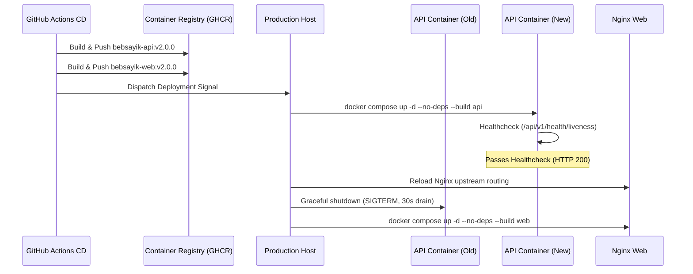

# Bebsayik.com — Production Deployment & Site Reliability Engineering Manual

**System:** Bebsayik.com — Multi-tenant SaaS ERP Platform  
**Target:** Production Containerization, High Availability, Disaster Recovery & SRE Operations  
**Version:** 2.0.0 (Hardened Master Production Standard)  

---

## 1. System Requirements & Hardware Sizing

### 1.1 Minimum Production Cluster Sizing (500–2,000 Active Shops)
- **API Nodes (Express Gateway):** 2× Dedicated Instances (c6i.xlarge or equivalent: 4 vCPU, 8 GB RAM per node).
- **Web Nodes (Nginx Multi-VHost):** 2× Dedicated Instances (t4g.medium or equivalent: 2 vCPU, 4 GB RAM).
- **Redis Node (Cache & Locks):** 1× Primary + 1× Replica with Sentinel (Redis 7+, 4 GB RAM, AOF persistence enabled).
- **Database (MongoDB Atlas):** Dedicated M30+ Replica Set (3-node Multi-AZ, 8 GB RAM, 2 vCPU, 40+ GB IOPS-optimized NVMe).

---

## 2. MongoDB Atlas Production Configuration

1. **Replica Set Architecture:**
   - 3-node Replica Set (Primary + 2× Secondaries across distinct Availability Zones).
   - Replica Set Name: `rs0` or provider-assigned name.
2. **ACID Transaction Invariant:**
   - Write Concern: `w: 'majority'`, `j: true` (Journaled write confirmations).
   - Read Concern: `readConcern: 'majority'`.
   - Read Preference: `primary` for all financial mutations and POS inventory deductions.
3. **Backup & Disaster Recovery Strategy:**
   - **Continuous Cloud Backups:** Enabled with Point-in-Time Recovery (PITR) with 1-minute granularity and 7-day retention.
   - **Scheduled Daily Snapshots:** Captured at 03:00 AM BST (UTC+6) with 30-day retention.
   - **Monthly Archive:** Stored in cold encrypted object storage for 7 years for NBR/tax audit compliance.
4. **Security & Network Peering:**
   - IP Access List: Restricted strictly to API container NAT Gateways (0.0.0.0/0 permanently forbidden in production).
   - TLS 1.3: Mandatory with Atlas-managed certificate rotation.
   - Encryption at Rest: AES-256 enabled with customer-managed AWS KMS keys.

---

## 3. Secret Management & Runtime Environment Injection

Production credentials must **NEVER** be committed to Git repositories or hardcoded into Docker images. Use one of the following injection pipelines:

### 3.1 Option A: AWS Secrets Manager / Parameter Store
```bash
# Retrieve production secrets and write to runtime env file with 0600 permissions
aws secretsmanager get-secret-value --secret-id bebsayik/production/env \
  --query SecretString --output text > /opt/bebsayik/.env.production
chmod 600 /opt/bebsayik/.env.production
```

### 3.2 Option B: Doppler Secret Operations
```bash
doppler run --project bebsayik --config prd -- docker compose -f docker-compose.prod.yml up -d
```

---

## 4. Zero-Downtime Rolling Deployment Workflow

The production cluster deploys updates with zero downtime using container rolling restarts:



### Step-by-Step Deployment Commands:
```bash
# 1. Pull latest verified release images
docker compose -f docker-compose.prod.yml pull

# 2. Start new API containers alongside active instances
docker compose -f docker-compose.prod.yml up -d --no-deps api

# 3. Verify API container liveness
docker compose -f docker-compose.prod.yml exec -T api wget -qO- http://localhost:5000/api/v1/health/liveness

# 4. Deploy updated Nginx web frontends
docker compose -f docker-compose.prod.yml up -d --no-deps web

# 5. Run post-deployment smoke test script
docker compose -f docker-compose.prod.yml exec -T api node scripts/smoke-test.js
```

---

## 5. Rollback Procedure

If unexpected regressions, elevated 5xx error rates, or data anomalies occur after a release:

```bash
# 1. Revert to previous release tag (e.g., v7.10.0)
export PREV_VERSION=v7.10.0
sed -i "s|bebsayik-api:latest|bebsayik-api:${PREV_VERSION}|g" docker-compose.prod.yml
sed -i "s|bebsayik-web:latest|bebsayik-web:${PREV_VERSION}|g" docker-compose.prod.yml

# 2. Redeploy previous containers
docker compose -f docker-compose.prod.yml up -d

# 3. Verify health and liveness
node scripts/smoke-test.js
```

---

## 6. Production Health Monitoring & Alerting

### 6.1 Structured JSON Logs
All backend logs are emitted in Winston structured JSON format with correlation IDs:
```json
{
  "timestamp": "2026-10-14T19:25:00.000Z",
  "level": "info",
  "message": "POS Checkout completed successfully",
  "shopId": "6709a12b3c4d5e6f7a8b9c00",
  "invoiceNo": "INV-202610-0042",
  "durationMs": 84,
  "grandTotal": "45000.00"
}
```

### 6.2 Critical Alert Thresholds
- **API 5xx Error Rate:** Alert on Slack/PagerDuty if 5xx errors exceed 1% over 5 minutes.
- **POS Checkout Latency:** Alert if p95 checkout response exceeds 250ms over 3 minutes.
- **MongoDB Connection Pool:** Alert if active connections exceed 80% of `MONGODB_MAX_POOL_SIZE`.
- **Redis Memory Utilization:** Alert if memory usage exceeds 85% of allocated RAM.
- **Disk Space (Host):** Alert if available root disk drops below 15%.
