# Bebsayik.com: User Flows & User Stories Specification
## Enterprise Mobile Shop & Retail ERP + POS SaaS Platform

**Version:** 4.1.0 (Master All-in-One Blueprint — Enterprise SaaS Edition)  
**Status:** Pre-Implementation Specification  
**Official Product Name:** Bebsayik  
**English Product Name:** Bebsayik.com  
**Brand:** Bebsayik  
**Brand Attribution:** Powered by Bebsayik  
**Primary Website Domain:** `bebsayik.com` (Intended canonical domain, subject to verification)  
**Legacy Business Context:** The initial ERP requirements and workflows originated from the Kanchan Telecom retail operation. The SaaS product is independently branded and operated as Bebsayik.com.  
**Target Market:** Mobile Phone, Gadget & Electronics Retailers (Bangladesh & Emerging Markets)  
**Document Owner:** Antigravity Engineering & Product Architecture  
**Baseline Documents:** `PRD.md` (v6.0.0), `saas-platform-audit.md`, `audit-report.md`, `idea.md`  

---

## 1. Executive Overview & Purpose

This document translates the business rules, multi-tenant architecture, and legacy Kanchan Telecom retail requirements into actionable, human-centered **User Personas**, **28 Step-by-Step User Flows**, and **Agile User Stories with Gherkin Acceptance Criteria** for **Bebsayik** (Bebsayik.com, Powered by Bebsayik).

It serves as the definitive reference for:
1. **Frontend / UX Engineers:** Designing wireframes, screen transitions, validation states, keyboard navigation, and modal interactions for both Web and Mobile Apps.
2. **Backend / API Engineers:** Implementing controllers, state machines, row-level concurrency locks, and ledger postings.
3. **QA / Test Automation Engineers:** Writing end-to-end integration test suites, BDD scenarios, and edge-case regression tests.

---

## 2. User Personas (Detailed User Profiles)

### Persona 1: Rahim Mia — The Shop Owner / Proprietor
- **Role:** Shop Super Admin / Owner.
- **Context:** Runs "Rahim Telecom & Gadget" in Eastern Plaza, Dhaka. Operates 1 showroom counter and 1 warehouse godown. Non-technical, values trust, zero tolerance for stock theft or staff leakage.
- **Primary Goals:**
  - Passwordless login via mobile OTP or fast 4-digit PIN on mobile app.
  - View real-time profit, net cash in hand, and total dues on his smartphone anytime.
  - Approve high-risk operations (discounts below MSP, credit limit waivers, voids, stock write-offs, fresh starts).
  - Receive automated SMS summaries at day-end with blind cash variance.
  - Ensure customer data is safe and portable (no vendor lock-in).

---

### Persona 2: Karim Uddin — The Store Manager
- **Role:** Manager / Floor Supervisor.
- **Context:** Oversees 3 cashiers, 1 technician, and daily physical inventory.
- **Primary Goals:**
  - Verify and authorize manager PIN overrides for below-MSP discounts, customer credit limit breaches, and invoice voids.
  - Supervise physical Goods Received Notes (GRN), Godown stock transfers (STN), and vendor purchase returns (PRV).
  - Review blind cash counts during day-end Z-Report closing.
  - Monitor overdue customer installments and direct collection calls.

---

### Persona 3: Tanvir Ahmed — The POS Cashier / Sales Executive
- **Role:** Sales / Cashier.
- **Context:** Handles rapid foot traffic during peak evening hours (5 PM to 10 PM). Needs fast scan-to-checkout without typing lags or mouse dependency.
- **Primary Goals:**
  - Scan barcodes and IMEIs instantly (<30ms).
  - 100% keyboard-driven checkout using function keys (`F1`-`F12`).
  - Handle mixed payments (e.g., ৳10,000 Cash + ৳5,000 bKash + ৳2,000 Due).
  - Seamlessly process **MFS Agent Cash Out Payments** when customers cash out to the shop's agent SIM.
  - Automatic change calculation without mental math mistakes (e.g., ৳400 bill, ৳500 note given = ৳100 change).
  - Hold and resume active carts when customers step away to withdraw money.

---

### Persona 4: Rafiq Islam — Inventory & Procurement Officer
- **Role:** Stock Keeper / Inventory Officer.
- **Context:** Ingests wholesale phone cartons from suppliers, assigns serials, transfers stock between Godown and Showroom.
- **Primary Goals:**
  - Bulk scan 50 IMEIs rapidly with duplicate detection.
  - Manage Partial PO delivery (supplier delivers 30 phones today, 20 tomorrow).
  - Process Stock Transfer Notes (STN) between Godown and Showroom with dispute checking.
  - Return defective phones to suppliers via Purchase Return Voucher (PRV).
  - Quarantine damaged or returned units for technician inspection.

---

### Persona 5: Sumon Dash — Service & Repair Technician
- **Role:** Hardware & Software Technician.
- **Context:** Works on a dedicated bench inside the shop repairing displays, charging ports, and water-damaged boards.
- **Primary Goals:**
  - Record incoming device condition, pattern locks, and customer complaint tickets.
  - Issue claim tokens with barcode tracking.
  - Dispense spare parts (e.g., OLED Display) from inventory, or return unused tested parts back to stock cleanly.
  - Track earned 50% labor commission split transparently.

---

### Persona 6: Platform Super Admin — Bebsayik Platform Operations Team
- **Role:** SaaS Platform Administrator (`admin.bebsayik.com`).
- **Context:** Oversees 500+ active shops across Bangladesh, monitors MRR, gateway health, and subscription renewals.
- **Primary Goals:**
  - View real-time platform growth KPIs, revenue charts, and payment success rates.
  - Manage shop accounts with non-destructive suspension rules.
  - Configure subscription plans with price versioning and snapshot protection.
  - Provide audited, time-limited customer support to shop owners.

---

## 3. Comprehensive End-to-End User Flows (29 Core Flows)

```
+---------------------------------------------------------------------------------------------------+
|                                 BEBSAYIK APP USER FLOW MAP (v4.0.0)                                |
+---------------------------------------------------------------------------------------------------+
| 1. Onboarding & Opening Balances  ──► 2. Morning Register Open  ──► 3. POS Sub-Second Sales       |
|                 │                                                            │                    |
|                 ▼                                                            ▼                    |
| 4. Procurement & Partial GRN      ──► 5. Purchase Return (PRV)   ──► 6. Sales Return / Exchange   |
|                 │                                                            │                    |
|                 ▼                                                            ▼                    |
| 7. Old Phone Trade-In (Buyback)   ──► 8. Kisti / EMI Engine     ──► 9. Amanat / Hawlat Ledger    |
|                 │                                                            │                    |
|                 ▼                                                            ▼                    |
| 10. MFS Desk & Mobile Recharge    ──► 11. Repair Job Sheets     ──► 12. Damage & Scrap Write-off  |
|                 │                                                            │                    |
|                 ▼                                                            ▼                    |
| 13. Cash In/Out & Transfers       ──► 14. Day-End Z-Report      ──► 15. SaaS Upgrade & Portability|
|                 │                                                            │                    |
|                 ▼                                                            ▼                    |
| 16. Keyboard-First Fast POS       ──► 17. Trade-In as Kisti DP  ──► 18. Godown STN Transfer       |
|                 │                                                            │                    |
|                 ▼                                                            ▼                    |
| 19. Technician Parts Return       ──► 20. Credit Limit Waiver   ──► 21. Offline Conflict Sync     |
|                 │                                                            │                    |
|                 ▼                                                            ▼                    |
| 22. Passwordless OTP Signup       ──► 23. POS Agent Cash Out    ──► 24. PayStation/EPS Subscription|
|                 │                                                            │                    |
|                 ▼                                                            ▼                    |
| 25. Website Free Trial Onboarding ──► 26. Admin Shop Suspension ──► 27. Mobile Device PIN Login   |
|                 │                                                            │                    |
|                 ▼                                                            ▼                    |
| 28. Mobile PIN Recovery via OTP   ──► 29. Remote Stolen Device Revocation──► 30. Web Password Reset via OTP|
|                 │                                                            │                    |
|                 ▼                                                            ▼                    |
| 31. Dual-OTP Mobile Number Change ──► 32. Staff Onboard & Termination   ──► 33. Shop Branding & Thermal Print|
|                                                                              │                    |
|                                                                              ▼                    |
|                                                                     34. Multi-Shop Workspace Switch|
+---------------------------------------------------------------------------------------------------+
```

---

### User Flow 1: New Shop Onboarding & First-Day Setup (Day 1 Go-Live)
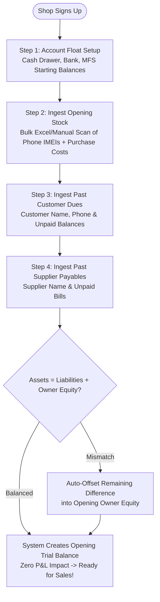

---

### User Flow 2: Morning Register Opening & Daily Cash Float
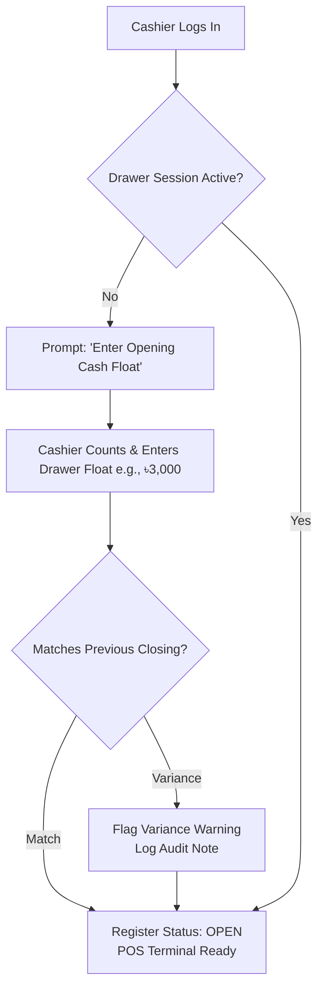

---

### User Flow 3: High-Speed POS Checkout & Multi-Tender Sale
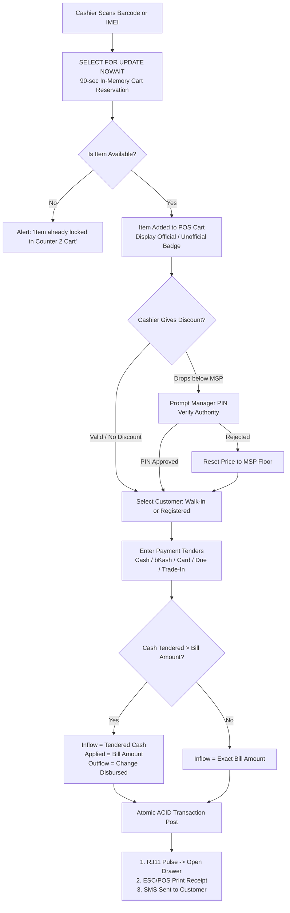

---

### User Flow 4: Procurement, PO & Partial GRN Goods Receiving
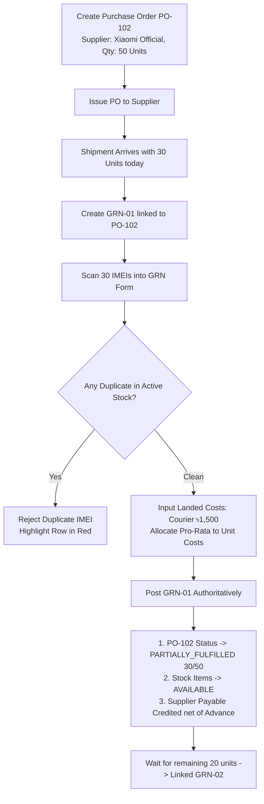

---

### User Flow 5: Purchase Return to Vendor (PRV) Workflow
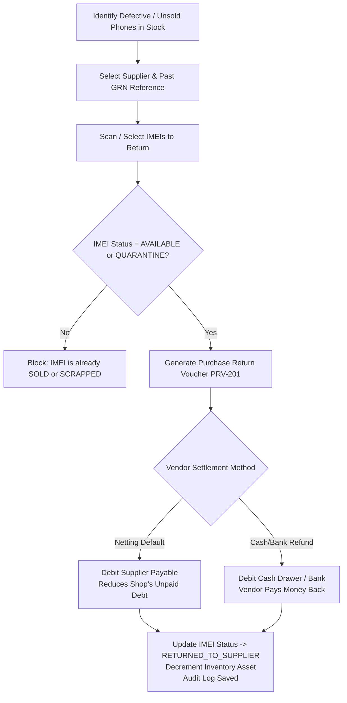

---

### User Flow 6: Sales Return, Refund & Exchange Decision Tree
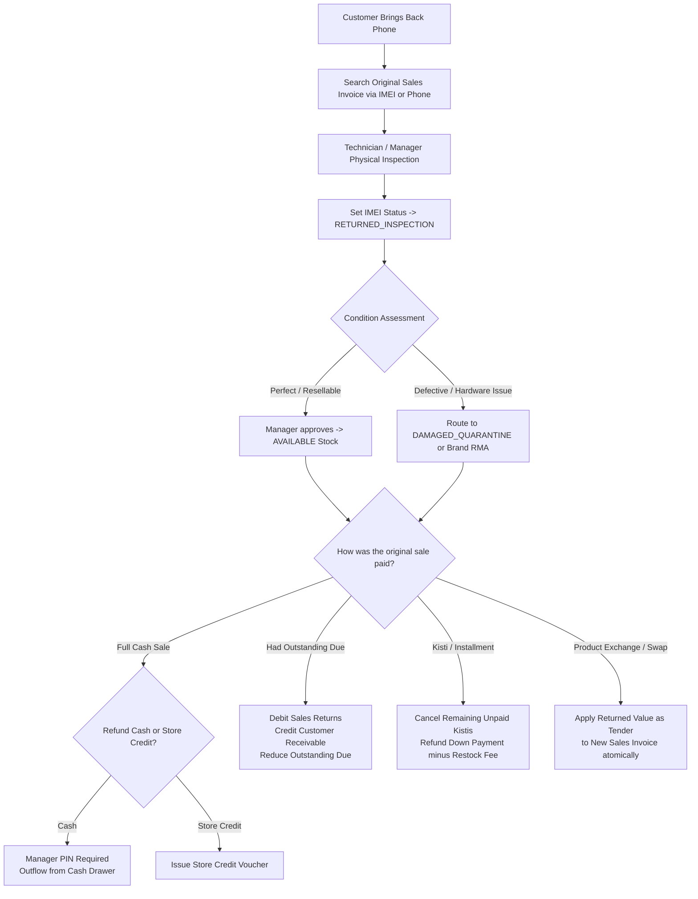

---

### User Flow 7: Old Phone Trade-In / Second-Hand Buyback
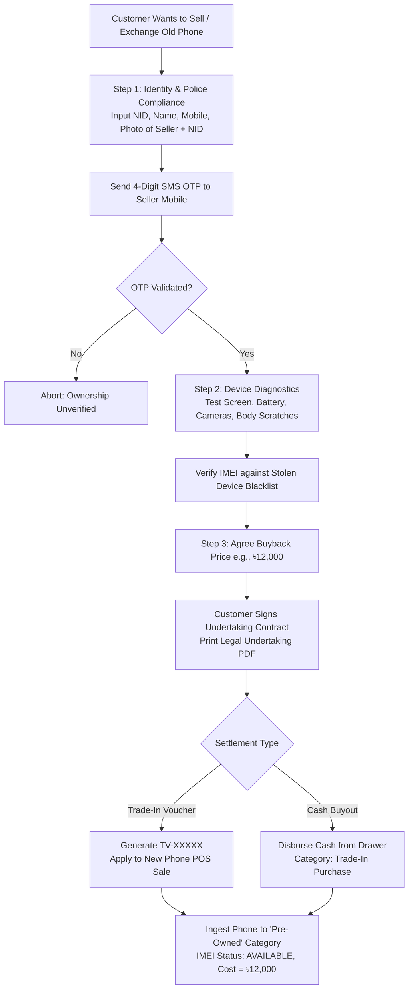

---

### User Flow 8: Installment (Kisti/EMI) Engine & Default Collection
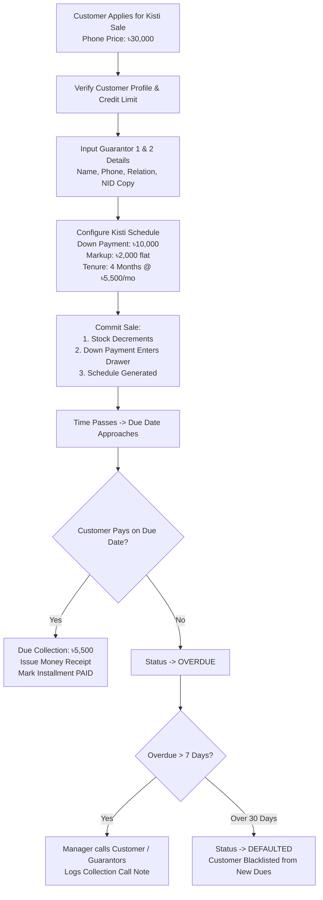

---

### User Flow 9: Amanat / Hawlat (Personal Ledger) Operations
```mermaid
flowchart TD
    OpenModule[Navigate to Amanat / Hawlat Module] --> SelectPerson[Select or Create Person in personal_ledger_contacts\ne.g., Neighbor Shopkeeper Alam Bhai]
    SelectPerson --> SelectType{Choose Transaction Type}
    SelectType -->|1. Amanat Deposit| AmnDeposit[Alam Bhai deposits ৳20,000 with shop\nCash Drawer increases (+৳20k)\nAlam Balance = +৳20,000 Shop Liability]
    SelectType -->|2. Amanat Withdraw| AmnWithdraw[Alam Bhai takes back ৳5,000\nCash Drawer decreases (-৳5k)\nAlam Balance = +৳15,000]
    SelectType -->|3. Expense on Person Behalf| AmnExp[Shop pays ৳2,000 courier bill FOR Alam\nCash Drawer decreases (-৳2k)\nAlam Balance = +৳13,000\nShop Expense = UNTOUCHED ৳0!]
    SelectType -->|4. Hawlat Given| HawGiven[Shop lends ৳10,000 to Alam\nCash Drawer decreases (-৳10k)\nAlam Balance = -৳10,000 Shop Receivable]
    SelectType -->|5. Hawlat Received| HawRecv[Alam repays ৳10,000\nCash Drawer increases (+৳10k)\nAlam Balance = ৳0]
    AmnDeposit --> SendSMSAlert[Instant SMS Notification to Person's Mobile]
    AmnWithdraw --> SendSMSAlert
    AmnExp --> SendSMSAlert
    HawGiven --> SendSMSAlert
    HawRecv --> SendSMSAlert
```

---

### User Flow 10: Dual-Mode MFS & Mobile Recharge (Flexiload)
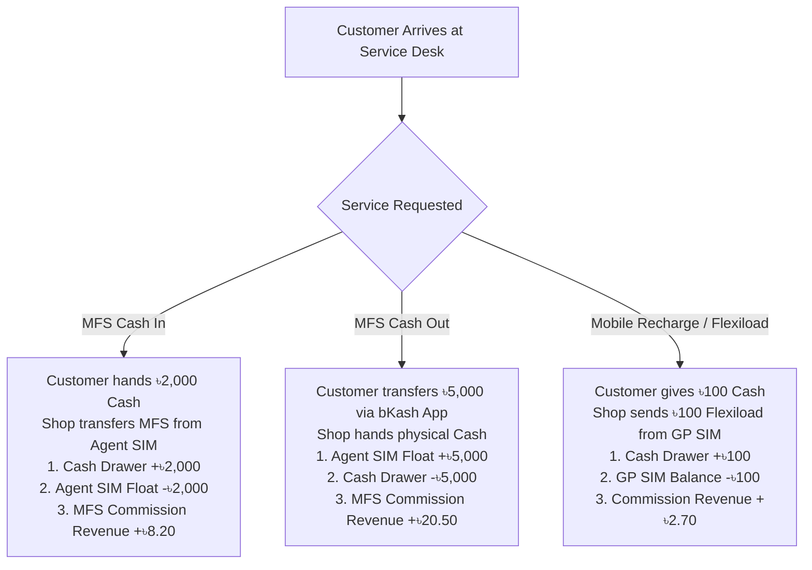

---

### User Flow 11: Repair & Servicing Job Sheet Workflow
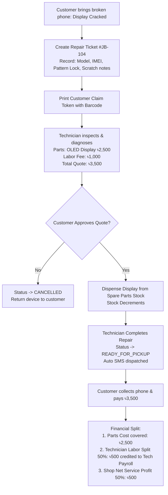

---

### User Flow 12: Damage, Quarantine & Scrap Write-Off Flow
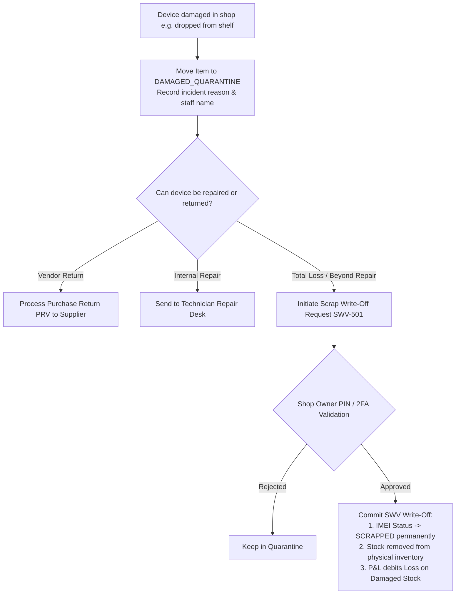

---

### User Flow 13: Cash In / Out & Inter-Account Transfers
```mermaid
flowchart TD
    TriggerCIO[User opens Cash In / Cash Out] --> SelectDir{Direction}
    SelectDir -->|Cash In| SelectDest[Select Destination Account e.g., Cash Drawer\nInput Amount & Reason e.g., Owner Capital]
    SelectDest --> PostCashIn[Post: Increases Cash Drawer\nClassified as Capital / Non-Sales Inflow]
    SelectDir -->|Cash Out| SelectSource[Select Source Account e.g., Cash Drawer]
    SelectSource --> BalanceCheck{Account Balance >= Amount?}
    BalanceCheck -->|No| FailClosed[BLOCK TRANSACTION:\n'Insufficient Funds! Negative Balance Forbidden']
    BalanceCheck -->|Yes| CounterCheck{Is Counter-Account Selected?}
    CounterCheck -->|Yes (Transfer)| DualLeg[Atomic Transfer:\nSource Decreases, Destination Increases\ne.g., Cash Drawer to Bank Deposit]
    CounterCheck -->|No (Direct Outflow)| SingleLeg[Outflow Recorded:\nReason: Staff Advance / Owner Drawing]
```

---

### User Flow 14: Evening Register Closing (Day-End Z-Report)
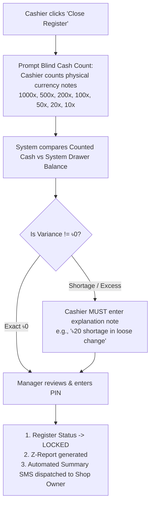

---

### User Flow 15: SaaS Freemium Upgrade & Billing Lifecycle
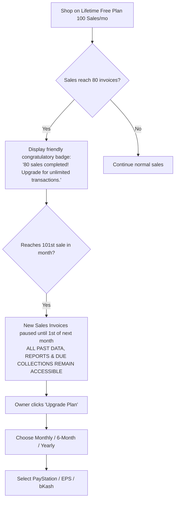

---

### User Flow 16: Ultra-Fast Keyboard-Driven POS Shortcut Flow
```mermaid
flowchart TD
    Idle[POS Screen Active] --> KeyPress{Cashier Presses Function Key}
    KeyPress -->|F3| FocusScan[Focus cursor on Barcode / IMEI Input Box]
    KeyPress -->|F2| FocusCust[Open Quick Customer Modal / Search]
    KeyPress -->|F8| FocusDisc[Jump cursor to Discount Field]
    KeyPress -->|F4| HoldCart[Execute Hold Cart (Assigned slot 1-10)]
    KeyPress -->|F5| ResumeCart[Open Resume Cart Modal]
    KeyPress -->|F1| OpenPay[Launch Checkout / Tender Payment Modal]
    KeyPress -->|F12| KickDrawer[Fire Manual Cash Drawer Kick (Manager Audited)]
    KeyPress -->|ESC| ClearInput[Clear Search / Dismiss Modal]
    OpenPay --> NavTender[Arrow Down / Tab to Tender Fields:\nCash, bKash, Card, Due, Agent Cash Out]
    NavTender --> PressEnter[Press Enter -> Execute Authoritative Sale Commit]
```

---

### User Flow 17: Hybrid Trade-In & Installment (Kisti) Down Payment Flow
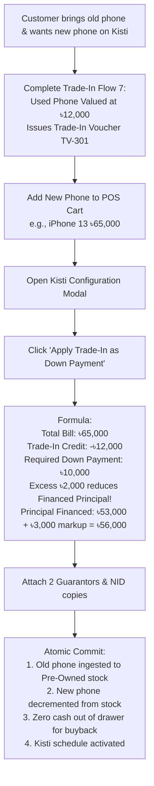

---

### User Flow 18: Godown to Outlet STN Flow & Dispute Handling
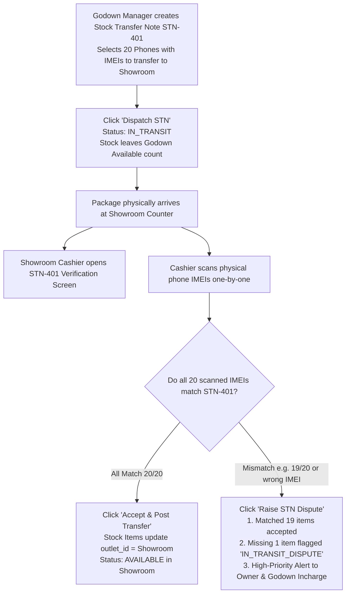

---

### User Flow 19: Technician Unused Spare Parts Return to Stock Flow
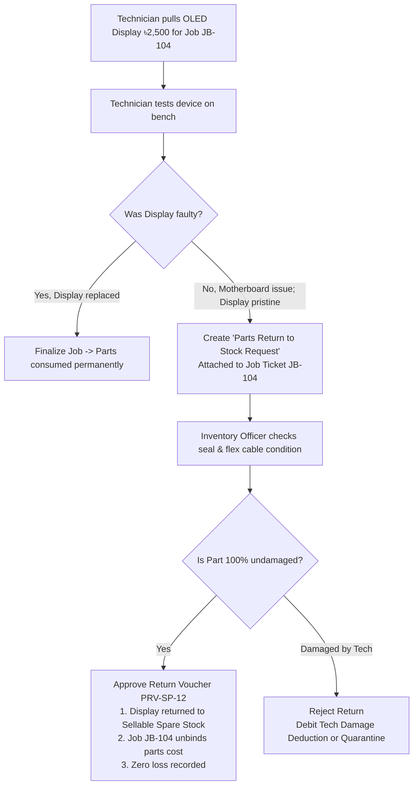

---

### User Flow 20: Customer Credit Limit Breach & Manager PIN Waiver Flow
```mermaid
flowchart TD
    AddCustomer[Cashier selects Registered Customer e.g., 'Arif Traders'] --> DisplayLimit[Display Customer Profile:\nCredit Limit: ৳20,000\nCurrent Due: ৳16,000\nAvailable Credit: ৳4,000]
    DisplayLimit --> RingSale[Cashier rings items totaling ৳10,000 Due]
    RingSale --> EvalBreach{New Due ৳26,000 > Credit Limit ৳20,000?}
    EvalBreach -->|Yes (Limit Breached)| HardLock[HARD LOCK CHECKOUT BUTTON\nDisplay Red Alert: 'Credit limit exceeded!']
    HardLock --> RequestOverride[Cashier clicks 'Request Manager PIN Override']
    RequestOverride --> PromptPIN[Prompt Manager / Owner 4-Digit Authorization PIN]
    PromptPIN --> ValidatePIN{Is PIN Valid?}
    ValidatePIN -->|Invalid 3 times| LockModal[Lock override for 5 minutes\nLog Security Audit]
    ValidatePIN -->|Valid PIN| InputReason[Manager enters mandatory note:\ne.g., 'Approved by Owner over phone for Eid']
    InputReason --> UnlockCommit[Unlock checkout button\nComplete Sale with Due\nLog AUDIT_CREDIT_WAIVER]
```

---

### User Flow 21: Offline-to-Online Conflict Sync & Automatic Reconciliation Flow
```mermaid
flowchart TD
    NetDrops[Broadband Internet Drops -> Offline PWA Active] --> OfflineSale[Cashier sells 2 Cables & 1 Screen Protector\nInvoice ID: OFFLINE-INV-802\nStored in Browser IndexedDB Queue]
    OfflineSale --> NetRestores[Internet Connection Restored]
    NetRestores --> ServiceWorker[Service Worker triggers Auto-Sync Queue]
    ServiceWorker --> SendBatch[Send Offline Queue to Backend with Idempotency Key]
    SendBatch --> CheckStockConflict{Did online counter deplete stock to 0 while offline?}
    CheckStockConflict -->|Stock Available| NormalPost[Post invoice cleanly\nAssign official Cloud Invoice ID\nSync complete]
    CheckStockConflict -->|Stock Deficit / Overdrawn| ConflictHandler[Execute Server-Authoritative Conflict Resolution:\n1. Invoice committed authoritatively (No customer dishonor)\n2. Stock record marked DRIFT_NEGATIVE\n3. System auto-generates Draft Stock Adjustment Voucher\n4. High-Priority Alert to Manager to physically audit shelf]
```

---

### User Flow 22: Passwordless OTP Registration & 3-Step Shop Setup Wizard
```mermaid
flowchart TD
    UserLand[User visits bebsayik.com/register] --> EnterPhone[Enter 11-digit Bangladeshi Mobile: 01XXXXXXXXX]
    EnterPhone --> ClickSend[Click 'Send Login OTP']
    ClickSend --> SMSDispatched[SMS Gateway sends 6-digit OTP code\nValidity: 120 seconds]
    SMSDispatched --> EnterOTP[User inputs 6-digit OTP]
    EnterOTP --> RateCheck{Attempts <= 3?}
    RateCheck -->|Exceeded| Block15[Block Phone for 15 minutes\nShow security alert]
    RateCheck -->|Valid| VerifyCode{OTP Matches?}
    VerifyCode -->|No| ShowError[Show 'Invalid OTP' Error]
    VerifyCode -->|Yes| CheckExisting{User already owns a Shop?}
    CheckExisting -->|Yes| DirectLogin[Issue JWT Session -> Enter Dashboard]
    CheckExisting -->|No (New User)| LaunchWizard[Launch 3-Step Shop Setup Wizard]
    LaunchWizard --> Wizard1[Step 1: Shop Profile Info\nName, Address, Market, Category, Trade License]
    Wizard1 --> Wizard2[Step 2: Counters & Outlets\nDefault Showroom Counter, Godown Selection]
    Wizard2 --> Wizard3PIN[Step 3: Setup 4-Digit Security PIN\nFor Mobile App & Sensitive Actions]
    Wizard3PIN --> QuickCommit[Atomically create shop record\nRole = SHOP_SUPER_ADMIN\nActivate 14-Day Free Gold Trial\nOpen POS Terminal]
```

---

### User Flow 23: POS MFS Agent Cash Out Payment Flow
```mermaid
flowchart TD
    BillReady[Total Bill Ready e.g., ৳10,000 for Samsung Phone] --> CustRequests[Customer says: 'I want to cash out to your Agent SIM']
    CustRequests --> SelectMethod[Cashier selects Payment Method:\n'MFS Agent Cash Out Payment']
    SelectMethod --> SelectSIM[Cashier selects Shop Agent SIM\ne.g., bKash Agent 01700-112233]
    SelectSIM --> PolicyCheck{Shop Fee Policy}
    PolicyCheck -->|Policy A: Customer Bears Fee| CustPaysFee[Formula: Bill ৳10,000 + 1.85% = ৳10,185\nCustomer cashes out ৳10,185\nShop receives net ৳10,000 in SIM]
    PolicyCheck -->|Policy B: Shop Absorbs Fee| ShopAbsorbs[Customer cashes out exactly ৳10,000\nShop absorbs fee]
    CustPaysFee --> CashierInput[Customer executes Cash Out from their bKash app\nCashier inputs Customer Mobile + bKash TrxID]
    ShopAbsorbs --> CashierInput
    CashierInput --> PostSale[Complete Sale Commit:\n1. Sales Revenue credits ৳10,000\n2. bKash Agent SIM Float debits +৳10,000\n3. Cash Drawer is UNTOUCHED ৳0 cash in/out\n4. Agent Commission credits +৳41.00]
    PostSale --> PrintReceipt[Thermal Invoice prints with details:\n'Payment: bKash Agent Cash Out\nAgent SIM: 01700-112233 | TrxID: BK789012']
```

---

### User Flow 24: PayStation / EPS Gateway SaaS Subscription Checkout & Auto-Renewal Flow
```mermaid
flowchart TD
    TriggerUpgrade[Shop reaches 80% free limit or clicks 'Upgrade Plan'] --> OpenBilling[Open SaaS Billing Modal]
    OpenBilling --> SelectTier[Select Tier: Premium / Gold / Diamond]
    SelectTier --> SelectTenure{Select Tenure}
    SelectTenure -->|1 Month| M1[Monthly Billing e.g., Gold ৳999]
    SelectTenure -->|6 Months| M6[6-Month Billing 10% Off Gold ৳5,395]
    SelectTenure -->|1 Year| M12[Yearly Billing 16% Off Gold ৳9,999]
    M1 --> ChooseGateway[Choose Payment Gateway]
    M6 --> ChooseGateway
    M12 --> ChooseGateway
    ChooseGateway -->|PayStation| RoutePayStation[Redirect to PayStation BD Hosted Checkout\nbKash, Nagad, Rocket, Cards, NetBanking]
    ChooseGateway -->|EPS Gateway| RouteEPS[Redirect to EPS Bangladesh\nDirect Bank Transfer, Internet Banking, Corporate Cards]
    ChooseGateway -->|bKash Direct| RoutebKash[Launch bKash 1-Click Tokenized Checkout]
    RoutePayStation --> CustomerPays[Customer completes payment on secure gateway]
    RouteEPS --> CustomerPays
    RoutebKash --> CustomerPays
    CustomerPays --> WebhookRecv[Gateway sends Server-to-Server Webhook]
    WebhookRecv --> VerifyHMAC{HMAC-SHA256 Signature Valid?}
    VerifyHMAC -->|Invalid| RejectWebhook[Reject & Log Security Alert]
    VerifyHMAC -->|Valid| IdempotentCheck{Has TrxID already been processed?}
    IdempotentCheck -->|Yes| Return200[Return HTTP 200 OK without duplicate credit]
    IdempotentCheck -->|No| ActivateTier[1. Update Shop Subscription -> ACTIVE\n2. Set new expiry_date\n3. Generate downloadable Tax Invoice PDF\n4. Dispatch Confirmation SMS to Owner]
```

---

### User Flow 25: Public Website Visitor to 14-Day Cardless Free Gold Trial Signup Flow
```mermaid
flowchart TD
    VisitPublic[Visitor visits bebsayik.com] --> ExplorePage[Explores Hero, Features, IMEI preview, Pricing comparison]
    ExplorePage --> ClickStartTrial[Clicks 'Start 14-Day Free Gold Trial' CTA]
    ClickStartTrial --> EnterMobile[Enters Mobile Number: 01XXXXXXXXX]
    EnterMobile --> DispatSMS[Gateway sends 6-digit SMS OTP]
    DispatSMS --> VerifyOTPInput[User types 6-digit OTP code]
    VerifyOTPInput --> CompleteWizard[Completes 3-Step Shop Wizard:\nShop Name, Address, Category, PIN]
    CompleteWizard --> AssignGold[System automatically activates 14-Day Free Gold Trial\nZero credit card / payment method required!]
    AssignGold --> RedirectERP[Redirects to app.bebsayik.com/dashboard\nDisplays welcoming badge: 'Your 14-day Gold trial has started!']
```

---

### User Flow 26: Central Platform Admin Shop Management & Non-Destructive Suspension Flow
```mermaid
flowchart TD
    AdminLogin[Platform Super Admin logs into admin.bebsayik.com] --> ViewShops[Navigates to /admin/shops directory]
    ViewShops --> SearchShop[Searches Shop #105 'Dhaka Gadgets']
    SearchShop --> ActionMenu[Clicks 'Shop Actions' dropdown]
    ActionMenu --> SelectSuspend[Selects 'Suspend Shop']
    SelectSuspend --> MandatoryReason[Inputs mandatory suspension reason:\ne.g., 'Copyright infringement complaint from Brand']
    MandatoryReason --> ConfirmSuspend[Confirms Suspension action]
    ConfirmSuspend --> ExecutePolicy[Non-Destructive Suspension Policy Executed:\n1. shops.status = SUSPENDED\n2. Zero inventory, sales or ledger records deleted\n3. Active user sessions revoked\n4. platform_audit_logs records admin action]
    ExecutePolicy --> OwnerAttempts[Shop Owner attempts login next morning]
    OwnerAttempts --> ShowNotice[Displays friendly notice:\n'Your account has been temporarily suspended.\nPlease contact support for details.']
```

---

### User Flow 27: Mobile App Device-Bound PIN Setup, Biometric Unlock & Fast Login Flow
```mermaid
flowchart TD
    OpenApp[User opens Bebsayik Android / iOS Mobile App] --> CheckAuth{Has authenticated on this device?}
    CheckAuth -->|First Time| MobileOTPAuth[Input Mobile Number + Verify 6-Digit SMS OTP]
    MobileOTPAuth --> PromptSetupPIN[Prompt: 'Set your 4-Digit Security PIN']
    PromptSetupPIN --> ConfirmPIN[Confirm 4-Digit PIN]
    ConfirmPIN --> StoreKeystore[Hash PIN via Argon2id\nStore cryptographically in Android Keystore / iOS Keychain\nBind session to device_instance_id]
    StoreKeystore --> PromptBio{Device supports Fingerprint / Face ID?}
    PromptBio -->|Yes| EnableBio[User enables Biometric Login toggle] --> EnterMobilePOS[Enter Mobile POS Dashboard]
    PromptBio -->|No| EnterMobilePOS
    CheckAuth -->|Subsequent Login| QuickAuth[App prompts Biometric Scan or 4-Digit PIN Keypad]
    QuickAuth --> VerifyKeypad{PIN / Biometric Valid?}
    VerifyKeypad -->|Correct| EnterMobilePOS
    VerifyKeypad -->|Incorrect 5 times| Lockout5[Lock app for 5 minutes\nDispatch SMS alert to Owner]
```

---

### User Flow 28: Mobile App Forgotten PIN / Account Recovery via SMS OTP Flow
```mermaid
flowchart TD
    KeypadLock[User cannot remember 4-digit Mobile App PIN] --> ClickForgot[Clicks 'Forgot PIN?' on keypad screen]
    ClickForgot --> ConfirmPhone[System displays registered mobile: 017XXXXXX44]
    ConfirmPhone --> ClickSendReset[User clicks 'Send Verification Code']
    ClickSendReset --> RateLimitCheck{Requested <= 3 times in 10 mins?}
    RateLimitCheck -->|Exceeded| BlockNotice[Wait 10 minutes notice]
    RateLimitCheck -->|Allowed| FireResetOTP[SMS Gateway delivers 6-digit recovery OTP]
    FireResetOTP --> EnterRecoveryOTP[User inputs 6-digit recovery OTP]
    EnterRecoveryOTP --> ValidateResetOTP{OTP Validated?}
    ValidateResetOTP -->|No| RedAlert[Invalid OTP alert]
    ValidateResetOTP -->|Yes| PromptNewPIN[Prompt: 'Enter New 4-Digit Security PIN']
    PromptNewPIN --> ConfirmNewPIN[Confirm New 4-Digit PIN]
    ConfirmNewPIN --> UpdateKeystore[Re-hash new PIN\nUpdate Android Keystore / iOS Keychain\nLog AUDIT_PIN_RESET event]
```

---

### User Flow 29: Remote Stolen Mobile Device Revocation Flow
```mermaid
flowchart TD
    PhoneLost[Staff or Owner loses phone / Phone is stolen] --> OwnerLogsWeb[Owner immediately logs into Web ERP at app.bebsayik.com]
    OwnerLogsWeb --> GoSettings[Navigates to: Shop Settings -> Devices & Security]
    GoSettings --> ViewDevices[Views list of active registered devices with hardware model & last login]
    ViewDevices --> ClickRevoke[Clicks 'Revoke Access' on the stolen device e.g., 'Redmi Note 12 - Cashier 1']
    ClickRevoke --> EnterOwnerPIN[Prompts Owner Security Password / PIN to confirm]
    EnterOwnerPIN --> ExecuteRevocation[Server executes atomic revocation:\n1. user_devices.is_active = FALSE\n2. user_devices.revoked_at = NOW()\n3. Auth Session JWT & Device Tokens revoked\n4. Fires SECURITY_ALERT SMS to registered mobile]
    ExecuteRevocation --> ThiefAttempts[Thief attempts to open Bebsayik app on stolen phone]
    ThiefAttempts --> BlockAccess[App immediately kicks out session:\n'Access for this device has been revoked.\nOwner SMS OTP verification is required to regain access.']
```

---

### User Flow 30: Web ERP Forgot Password & Argon2id Password Reset via SMS OTP
```mermaid
flowchart TD
    ForgotPass[User forgets Web ERP Password on app.bebsayik.com] --> ClickForgot[Clicks 'Forgot Password / Recover Account']
    ClickForgot --> EnterPhone[Inputs 11-digit registered mobile number & solves Turnstile Captcha]
    EnterPhone --> RateLimitCheck{Requests <= 3 in 15 mins?}
    RateLimitCheck -->|Exceeded| BlockWait[Rate limited: 'Please wait 15 minutes before requesting another OTP']
    RateLimitCheck -->|Allowed| SendWebOTP[SMS Gateway delivers 6-digit cryptographic recovery OTP\nTTL: 120 seconds]
    SendWebOTP --> InputOTP[User enters 6-digit OTP]
    InputOTP --> ValidateOTP{OTP Valid & attempts <= 3?}
    ValidateOTP -->|Invalid| RedAlert[Display error: 'Invalid or expired OTP. Attempts remaining: N']
    ValidateOTP -->|Valid| SetNewPass[Prompt: 'Enter New Password'\nMin 8 chars, 1 uppercase, 1 number, 1 symbol]
    SetNewPass --> ConfirmPass[User confirms new password]
    ConfirmPass --> ExecuteReset[Server executes atomic password reset:\n1. Hashes password via Argon2id\n2. Updates users.passwordHash\n3. Sets passwordChangedAt = NOW()\n4. Increments tokenVersion to revoke all active sessions\n5. Logs AUDIT_PASSWORD_RESET event]
    ExecuteReset --> NotifySMS[SMS Gateway dispatches confirmation:\n'Your Bebsayik password has been reset successfully.']
    NotifySMS --> RedirectLogin[Redirects to app.bebsayik.com/login with success toast]
```

---

### User Flow 31: Registered Mobile Phone Number Migration (Dual-OTP Handshake)
```mermaid
flowchart TD
    StartMigrate[Owner / Staff changes SIM card or ports number] --> LoginAuth[Logs into Web ERP or Mobile App via current credentials]
    LoginAuth --> GoSec[Navigates to: Settings -> Security -> 'Change Mobile Number']
    GoSec --> VerifyCreds[Re-authenticates with current Password or 4-digit Manager PIN]
    VerifyCreds --> EnterNewNum[Inputs New 11-Digit BD Number: 01XXXXXXXXX]
    EnterNewNum --> CheckUnique{New Number already registered to active user?}
    CheckUnique -->|Yes| BlockConflict[Error: 'This mobile number is already registered to another Bebsayik account']
    CheckUnique -->|No| InitiateDualOTP[System initiates Dual-OTP Handshake:\n1. Creates phone_change_requests record\n2. Dispatches OTP-1 to OLD phone 'Approval OTP'\n3. Dispatches OTP-2 to NEW phone 'Verification OTP'\nWindow: 180 seconds]
    InitiateDualOTP --> EnterBothOTPs[User enters OTP-1 from old SIM and OTP-2 from new SIM]
    EnterBothOTPs --> ValidateDual{Both OTPs Valid & Timely?}
    ValidateDual -->|Mismatch| RejectMigrate[Alert: 'OTP verification failed. Phone change aborted.']
    ValidateDual -->|Matched| CommitMigration[Database executes atomic migration:\n1. users.phone = newPhone\n2. If Owner: shops.phone = newPhone\n3. users.tokenVersion += 1 to kill old device sessions\n4. phone_change_requests.status = 'completed'\n5. Logs AUDIT_PHONE_NUMBER_CHANGED with IP & Device ID]
    CommitMigration --> AlertBoth[Sends SMS confirmation to both Old and New SIMs]
    AlertBoth --> ReLogin[User logs in seamlessly using New Mobile Number]
```

---

### User Flow 32: Staff Account Provisioning, Role Assignment & Emergency Termination
```mermaid
flowchart TD
    OwnerAction[Shop Owner hires new employee e.g., Cashier or Technician] --> OpenStaffSettings[Navigates to: Shop Settings -> Staff Management]
    OpenStaffSettings --> ClickAddStaff[Clicks 'Add Staff Member']
    ClickAddStaff --> FillStaffForm[Inputs Staff Details:\n1. Full Name & Mobile Number\n2. Assigns Role: CASHIER / STOCK_KEEPER / TECHNICIAN / MANAGER\n3. Base Salary & Commission Rate %\n4. Emergency Contact & NID]
    FillStaffForm --> SendInvite[Server generates temporary one-time PIN\nDispatches welcome SMS with app download link & temporary PIN]
    SendInvite --> StaffFirstLogin[Staff downloads mobile app, enters mobile & temporary PIN]
    StaffFirstLogin --> ForcePinChange[App forces staff to set permanent 4-digit PIN\nStores hardware-bound Argon2id hash in user_devices]
    ForcePinChange --> CounterWork[Staff executes shift operations under assigned RBAC permissions]
    
    subgraph Emergency Termination Protocol
        Dispute[Staff resignation, theft, or termination] --> OwnerTerminate[Owner clicks 'Terminate Staff' in Staff Management]
        OwnerTerminate --> PromptManagerPIN[Prompts Owner Security Password to confirm termination]
        PromptManagerPIN --> ExecuteKill[Server executes immediate termination:\n1. users.isActive = FALSE\n2. users.tokenVersion += 1 (Instant session kill)\n3. All user_devices marked isRevoked = TRUE\n4. Logs AUDIT_STAFF_TERMINATED event]
        ExecuteKill --> InstantKickout[Active mobile POS tablet on cashier counter instantly locks\n'Account terminated by shop owner'\nSubsequent logins permanently blocked]
    end
```

---

### User Flow 33: Shop Profile Branding & Thermal Receipt Printer Setup
```mermaid
flowchart TD
    GoShopSettings[Owner navigates to: Shop Settings -> Shop Profile & Branding] --> UploadLogo[Uploads Shop Logo PNG/JPG for thermal receipt header]
    UploadLogo --> ConfigHeaderFooter[Configures Thermal Receipt Metadata:\n1. Store Heading e.g., 'Bismillahir Rahmanir Rahim'\n2. Trade License & Mushak 6.3 VAT BIN Number\n3. Footer Return Policy e.g., 'Return allowed within 7 days with invoice']
    ConfigHeaderFooter --> SelectPrinter[Selects Thermal Printer Settings:\nPaper Width: 58mm or 80mm\nInterface: WebUSB / Bluetooth / ESC-POS Network]
    SelectPrinter --> TestPrintClick[Clicks 'Test Print Receipt & Pulse Cash Drawer']
    TestPrintClick --> DriverStream[Browser streams raw ESC/POS bitmap & text to printer]
    DriverStream --> PhysicalCheck{Receipt printed clearly & Drawer kicked?}
    PhysicalCheck -->|No| Calibrate[Adjust font density, baud rate, or paper margin]
    PhysicalCheck -->|Yes| SaveConfig[Saves shop_hardware_configs\nAll future counter sales print customized receipt with logo]
```

---

### User Flow 34: Multi-Shop Workspace Switching for Multi-Outlet Retailer
```mermaid
flowchart TD
    MultiOwner[Retailer owns 2 mobile shops e.g., 'Kanchan Telecom Counter 1' and 'Kanchan Godown'] --> LoginUnified[Logs in using single registered mobile phone]
    LoginUnified --> CheckTenants{User has role in multiple shops?}
    CheckTenants -->|Single Shop| MountDefault[Mounts single shop ERP dashboard directly]
    CheckTenants -->|Multiple Shops| MountSwitcher[Header renders Shop Workspace Switcher dropdown]
    MountSwitcher --> UserSelectsShop[Owner selects 'Kanchan Godown' from workspace menu]
    UserSelectsShop --> SwitchRequest[Client dispatches POST /api/v1/auth/switch-tenant { targetShopId }]
    SwitchRequest --> VerifyAccess{User authorized as Owner/Manager for targetShopId?}
    VerifyAccess -->|Denied| SecurityError[403 Forbidden alert]
    VerifyAccess -->|Approved| IssueScopedToken[Server issues new short-lived JWT scoped to targetShopId]
    IssueScopedToken --> HotSwapState[Zustand store hot-swaps state:\n1. Loads godown inventory & STN vouchers\n2. Loads godown cash drawer balances\n3. Zero browser reload required]
```

---

## 4. Agile User Stories with Gherkin Acceptance Criteria

### Epic 1 to Epic 19 (Preserved Core Stories):
*(Epics 1 through 19 covering Opening Balance, Cart Concurrency, Change Arithmetic, PRV, Sales Return Quarantine, Trade-In, Kisti Ledger, Amanat "Expense on Behalf", Damage Scrap SWV, Zero Negative Balance, Freemium Limits, Keyboard F1-F12, Hybrid Trade-In Kisti, STN Verification, Technician Parts Return, Credit Limit Waiver, Offline Sync, Passwordless OTP Signup, POS Agent Cash Out, and SaaS Checkout are fully active and preserved from v3.0.0).*

---

### Epic 20: Public Website & Conversion Funnel (`bebsayik.com`)
#### Story 20.1: As a prospective mobile retailer visiting `bebsayik.com`, I want to understand the software features and start a 14-day Gold trial without entering a credit card, so that I can test the app without financial commitment.
```gherkin
Scenario: Prospective retailer starts cardless 14-day Gold trial from landing page
  Given I am an unauthenticated visitor on "bebsayik.com"
  When I explore the feature showcase and click "Start 14-Day Free Gold Trial"
  And I enter my mobile number "01711223344" and verify the SMS OTP
  And I complete the 3-step shop setup wizard with shop name "City Telecom"
  Then my shop is created with tenant isolation
  And my subscription is automatically activated on the Gold Tier for 14 days
  And no credit card or payment gateway prompt is shown

---

### Epic 21: User Profile, Security, Identity Migration & Multi-Tenant Switching

#### Story 21.1: As an existing shopkeeper whose SIM card is being ported, I want to migrate my registered Bebsayik mobile number via a dual-OTP verification, so that my account credentials and historical records transfer to my new number with zero data loss.
```gherkin
Scenario: Shop owner migrates registered mobile number via Dual-OTP handshake
  Given I am logged in as "Shop Owner" on "app.bebsayik.com"
  When I navigate to "Shop Settings -> Security" and select "Change Registered Mobile Number"
  And I re-authenticate by entering my current password
  And I enter my new mobile number "01811223344"
  Then the system dispatches "Approval OTP" to "01711223344" and "Verification OTP" to "01811223344"
  When I enter both valid 6-digit OTPs within 180 seconds
  Then my user profile and shop tenant phone number are updated to "01811223344"
  And an immutable "AUDIT_PHONE_NUMBER_CHANGED" event is logged
  And both phone numbers receive confirmation SMS notifications
  And I am redirected to login using my new mobile number
```

#### Story 21.2: As a shop owner who has terminated a cashier due to discrepancies, I want to immediately terminate the cashier's account from my phone, so that their active counter POS session is revoked in under 1 second.
```gherkin
Scenario: Shop owner executes emergency termination on cashier account
  Given Cashier "Rahim" is currently logged in on the counter Android POS tablet
  When I navigate to "Shop Settings -> Staff Management" from my mobile app
  And I select "Rahim" and click "Terminate Staff Member"
  And I confirm the action with my 4-digit Security PIN
  Then Rahim's user status is immediately set to inactive
  And Rahim's device session token is invalidated on the server
  And Rahim's POS tablet screen locks instantly with "Account Terminated by Shop Owner"
  And all subsequent PIN and biometric login attempts by Rahim are blocked
```

#### Story 21.3: As a shopkeeper forgetting my web password, I want to reset my password using an SMS OTP on my registered phone, so that I can securely regain access to my Web ERP.
```gherkin
Scenario: Unauthenticated merchant resets forgotten web password
  Given I am an unauthenticated user on "app.bebsayik.com/recovery"
  When I enter my registered mobile number "01711223344" and solve the Turnstile challenge
  Then a 6-digit cryptographic OTP is dispatched to my phone
  When I input the valid OTP and choose a new 10-character password "Bebsayik#2026"
  Then my password hash is updated using Argon2id
  And all previous active web sessions and mobile tokens are invalidated
  And I receive a confirmation SMS notifying me of the credential change
  And I am able to log into "app.bebsayik.com" with my new password
```
  And I am directed to "app.bebsayik.com/dashboard"
```

---

### Epic 21: Central Platform Admin & Non-Destructive Suspension
#### Story 21.1: As a Platform Super Admin on `admin.bebsayik.com`, I want to suspend a fraudulent shop without deleting their database records, so that business history is preserved for legal compliance while blocking access.
```gherkin
Scenario: Non-destructive shop suspension from Admin Panel
  Given I am an authenticated Platform Super Admin on "admin.bebsayik.com"
  When I locate Shop ID "105" and click "Suspend Shop"
  And I enter mandatory reason "Copyright dispute notice received"
  Then the shop status in the database updates to "SUSPENDED"
  And zero inventory, sales, or customer records are deleted
  When the owner of Shop "105" attempts to log in
  Then login is blocked with notice: "Your account is temporarily suspended. Contact support."
```

---

### Epic 22: Mobile Device-Bound PIN & Account Recovery
#### Story 22.1: As a busy shopkeeper using the Mobile App, I want to log in using a 4-digit PIN or fingerprint in 2 seconds, so that I don't have to wait for an SMS OTP every time I open the app.
```gherkin
Scenario: Fast device-bound PIN login on Mobile App
  Given I have previously authenticated on my mobile device and set 4-digit PIN "5892"
  When I open the Bebsayik mobile app
  Then the app prompts for 4-digit PIN or fingerprint biometric
  When I enter "5892" or scan my fingerprint
  Then the cryptographic session key stored in Android Keystore / iOS Keychain unlocks
  And I enter the Mobile POS terminal within 500ms
```

---

### Epic 23: Remote Stolen Mobile Device Revocation
#### Story 23.1: As a shop owner whose staff lost their shop mobile phone, I want to revoke that device's access remotely from the Web ERP settings, so that a thief cannot access our sales data or cash drawer even with the 4-digit PIN.
```gherkin
Scenario: Owner revokes stolen device remotely from Web ERP
  Given I am logged in as Shop Owner on "app.bebsayik.com/settings/devices"
  When I find device "Redmi Note 12 - Counter 1" and click "Revoke Access"
  And I confirm my action with my Owner password
  Then the record in "user_devices" is marked with is_active = false and revoked_at timestamp
  And all active JWT sessions for that device hardware ID are terminated immediately
  When anyone tries to open the Bebsayik mobile app on the stolen phone
  Then the app instantly boots back to the initial login screen with access revoked
```

---

## 5. Exception & Edge-Case Handling Matrix

| Edge Case Scenario | System Reaction & Guardrail | User Experience Message |
|---|---|---|
| **Invalid mobile PIN entered 5 times consecutively** | Mobile app locked for 5 minutes; security audit event fired to owner's registered number. | *"Incorrect PIN entered 5 times. For security, please wait 5 minutes."* |
| **User switches to a new phone or reinstalls app** | Device-bound PIN cannot be used on untrusted hardware; prompts for mandatory 6-digit SMS OTP verification before creating new PIN. | *"To log in on a new device, enter the OTP sent to your mobile number."* |
| **Public visitor clicks App Store badge before release** | Opens modal capturing mobile number for pre-launch SMS notification; records lead in platform admin marketing list. | *"App coming soon! Enter your mobile number to receive launch updates via SMS."* |
| **Admin increases Gold Plan price from ৳999 to ৳1,199** | Existing Gold subscribers retain active period at previous rate; price snapshot preserved until subsequent renewal. | Zero price shock; updated price only applies to new invoices. |
| **Customer pays via Agent Cash Out with wrong amount** | POS checks entered amount against expected bill. Rejects commit if difference exists. | *"Cash out amount does not match the bill amount. Please verify."* |
| **PayStation / EPS webhook delayed due to network** | 3-minute background polling reconciler queries gateway status API. Updates subsc
<truncated 1027 bytes>

NOTE: The output was truncated because it was too long. Use a more targeted query or a smaller range to get the information you need.